# Báo Cáo Khoa Học Toàn Diện: Giải Quyết Bài Toán Pacman & Học Máy CS188 (Projects 1, 2, 3, 5) và Mở Rộng Thực Nghiệm Quy Mô Lớn trên Đô Thị "Pacman Mega-City"

**Học phần:** Trí tuệ Nhân tạo (Artificial Intelligence — UC Berkeley CS188 / AIT2004)  
**Kho mã nguồn:** `AIT2004_7` ([`search/`](../search), [`multiagent/`](../multiagent), [`reinforcement/`](../reinforcement), [`machinelearning/`](../machinelearning), [`experiments/`](./))  
**Điểm Autograder chuẩn CS188:** **102 / 100** (Project 1: **26/25**, Project 2: **25/25**, Project 3: **26/25**, Project 5: **25/25**)

---

## Mục Lục
1. [Tổng quan Mục tiêu & Kiến trúc Toàn Dự án](#1-tổng-quan-mục-tiêu--kiến-trúc-toàn-dự-án)
2. [Phần I — Kết quả Thực hiện 4 Project Gốc (CS188 Core Submissions)](#2-phần-i--kết-quả-thực-hiện-4-project-gốc-cs188-core-submissions)
   - [2.1. Project 1: Tìm kiếm trong Không gian Trạng thái (`search`) — 26/25 điểm](#21-project-1-tìm-kiếm-trong-không-gian-trạng-thái-search--2625-điểm)
   - [2.2. Project 2: Tìm kiếm Đối kháng Đa tác tử (`multiagent`) — 25/25 điểm](#22-project-2-tìm-kiếm-đối-kháng-đa-tác-tử-multiagent--2525-điểm)
   - [2.3. Project 3: Quy hoạch Động MDP & Học Tăng cường (`reinforcement`) — 26/25 điểm](#23-project-3-quy-hoạch-động-mdp--học-tăng-cường-reinforcement--2625-điểm)
   - [2.4. Project 5: Học Máy & Mạng Nơ-ron Sâu (`machinelearning`) — 25/25 điểm](#24-project-5-học-máy--mạng-nơ-ron-sâu-machinelearning--2525-điểm)
3. [Phần II — Thiết kế Kịch bản Mở rộng & Đô thị Hợp nhất "Pacman Mega-City"](#3-phần-ii--thiết-kế-kịch-bản-mở-rộng--đô-thị-hợp-nhất-pacman-mega-city)
4. [Phần III — Kết quả & Phân tích Chuyên sâu Các Thí nghiệm Mở rộng (A – I)](#4-phần-iii--kết-quả--phân-tích-chuyên-sâu-các-thí-nghiệm-mở-rộng-a--i)
   - [4.1. Thí nghiệm A: Mở rộng Kích thước Mê cung ($31^2 \to 151^2$) & Địa hình Đầm lầy](#41-thí-nghiệm-a-mở-rộng-kích-thước-mê-cung-312-to-1512--địa-hình-đầm-lầy)
   - [4.2. Thí nghiệm B: Bùng nổ Tổ hợp Multi-Food ($k = 3 \to 11$) & Tiền tính toán Khoảng cách + MST](#42-thí-nghiệm-b-bùng-nổ-tổ-hợp-multi-food-k--3-to-11--tiền-tính-toán-khoảng-cách--mst)
   - [4.3. Thí nghiệm C: Đấu trường Đối kháng 3 Ghosts — Kiểm chứng Giả thuyết Khoảng cách Mê cung & Giá trị Kết thúc Hữu hạn](#43-thí-nghiệm-c-đấu-trường-đối-kháng-3-ghosts--kiểm-chứng-giả-thuyết-khoảng-cách-mê-cung--giá-trị-kết-thúc-hữu-hạn)
   - [4.4. Thí nghiệm D: Hiệu quả Cắt tỉa Alpha-Beta & Sắp xếp Nước đi (Move Ordering)](#44-thí-nghiệm-d-hiệu-quả-cắt-tỉa-alpha-beta--sắp-xếp-nước-đi-move-ordering)
   - [4.5. Thí nghiệm E: Hội tụ Bellman trên MDP Lớn ($5^2 \to 40^2$) — State Backups vs Q-Evaluations](#45-thí-nghiệm-e-hội-tụ-bellman-trên-mdp-lớn-52-to-402--state-backups-vs-q-evaluations)
   - [4.6. Thí nghiệm F: Khái quát hóa Q-Learning, Đối chứng IdentityExtractor & Chuyển giao Zero-Shot sang Mega-City](#46-thí-nghiệm-f-khái-quát-hóa-q-learning-đối-chứng-identityextractor--chuyển-giao-zero-shot-sang-mega-city)
   - [4.7. Thí nghiệm G: Mở rộng Ma trận Tích chập 2D (`Naive` vs `models.Convolve` vs `F.conv2d`)](#47-thí-nghiệm-g-mở-rộng-ma-trận-tích-chập-2d-naive-vs-modelsconvolve-vs-fconv2d)
   - [4.8. Thí nghiệm H & H2: Độ phức tạp $O(T^2)$ của Self-Attention & Huấn luyện Mô hình Ngôn ngữ Ký tự (Char-LM)](#48-thí-nghiệm-h--h2-độ-phức-tạp-ot2-của-self-attention--huấn-luyện-mô-hình-ngôn-ngữ-ký-tự-char-lm)
   - [4.9. Thí nghiệm I: Kết nối Project 2 $\leftrightarrow$ Project 5 — Học Bắt chước (Imitation Learning) trên Mega-City](#49-thí-nghiệm-i-kết-nối-project-2-leftrightarrow-project-5--học-bắt-chước-imitation-learning-trên-mega-city)
5. [Tổng kết Đối chiếu Giữa Các Phương pháp & Hướng dẫn Tái lập](#5-tổng-kết-đối-chiếu-giữa-các-phương-pháp--hướng-dẫn-tái-lập)

---

## 1. Tổng quan Mục tiêu & Kiến trúc Toàn Dự án

Dự án hoàn thiện toàn bộ 4 bài tập lớn cốt lõi của giáo trình **UC Berkeley CS188 (Intro to AI)** và xây dựng một khung thực nghiệm mở rộng quy mô lớn ([`experiments/`](./)) nhằm trả lời câu hỏi nghiên cứu xuyên suốt:

> **Khi kích thước ma trận trạng thái tăng từ quy mô đồ chơi ($7\times 7 \to 20\times 11$) lên quy mô đô thị phức hợp ($31\times 21 \to 151\times 151$, nhiều viên thức ăn, 3 Ghosts săn đuổi, địa hình đầm lầy trọng số lớn, chuỗi token dài $T=512$), giới hạn tính toán của từng nhóm thuật toán (Tìm kiếm đồ thị, Cây trò chơi đối kháng, Quy hoạch động / Học tăng cường, và Mạng nơ-ron sâu) xuất hiện ở đâu và làm thế nào để khắc phục?**

| Hợp phần | Thư mục gốc | Các tệp mã nguồn hoàn thiện | Điểm Autograder | Thí nghiệm Mở rộng Liên kết |
| :--- | :--- | :--- | :---: | :--- |
| **Project 1: Search** | [`search/`](../search) | [`search.py`](../search/search.py), [`searchAgents.py`](../search/searchAgents.py) | **26 / 25** | **Exp A** (`search_scaling.csv`), **Exp B** (`search_food.csv`) |
| **Project 2: Multi-Agent** | [`multiagent/`](../multiagent) | [`multiAgents.py`](../multiagent/multiAgents.py) | **25 / 25** | **Exp C** (`multiagent_games.csv`), **Exp D** (`multiagent_pruning.csv`) |
| **Project 3: RL & MDP** | [`reinforcement/`](../reinforcement) | [`valueIterationAgents.py`](../reinforcement/valueIterationAgents.py), [`qlearningAgents.py`](../reinforcement/qlearningAgents.py), [`analysis.py`](../reinforcement/analysis.py) | **26 / 25** | **Exp E** (`rl_mdp_summary.csv`, `rl_mdp_curves.csv`), **Exp F** (`rl_pacman.csv`) |
| **Project 5: Deep Learning** | [`machinelearning/`](../machinelearning) | [`models.py`](../machinelearning/models.py), [`train.py`](../machinelearning/train.py) | **25 / 25** | **Exp G** (`ml_convolve_scaling.csv`), **Exp H & H2** (`ml_attention_scaling.csv`, `ml_char_lm.csv`), **Exp I** (`ml_imitation.csv`) |
| **Tổng cộng** | | **10 tệp bài nộp chuẩn + 6 tệp thực nghiệm** | **102 / 100** | **9 bộ dữ liệu CSV + 11 biểu đồ PNG** |

---

## 2. Phần I — Kết quả Thực hiện 4 Project Gốc (CS188 Core Submissions)

### 2.1. Project 1: Tìm kiếm trong Không gian Trạng thái (`search`) — 26/25 điểm

Trong [`search/search.py`](../search/search.py) và [`search/searchAgents.py`](../search/searchAgents.py), chúng tôi cài đặt một khung tìm kiếm đồ thị tổng quát (`_graphSearch`) dùng chung cho cả 4 thuật toán (Q1–Q4) bằng cách trừu tượng hóa cấu trúc hàng đợi biên (`frontier`) thông qua hàm đẩy `push_fn`:

1. **Q1 — Depth-First Search (`depthFirstSearch`, 3/3đ):** Dùng ngăn xếp `util.Stack` (LIFO), kiểm tra tập đóng `visited` khi lấy nút ra khỏi ngăn xếp (đúng chuẩn autograder CS188). Trên `mediumMaze`, DFS mở rộng **146 nút** (chi phí 130); trên `bigMaze` ($37\times 37$), DFS mở rộng **390 nút** (chi phí 210).
2. **Q2 — Breadth-First Search (`breadthFirstSearch`, 3/3đ):** Dùng hàng đợi `util.Queue` (FIFO), đảm bảo tìm đường ngắn nhất theo số bước. Mở rộng **269 nút** (chi phí 68) trên `mediumMaze` và **620 nút** (chi phí 210) trên `bigMaze`.
3. **Q3 — Uniform Cost Search (`uniformCostSearch`, 3/3đ):** Dùng `util.PriorityQueue` với độ ưu tiên là chi phí tích lũy $g(n)$. Đảm bảo tối ưu trên mọi hàm chi phí dương (`StayEastSearchAgent`, `StayWestSearchAgent`).
4. **Q4 — A\* Search (`aStarSearch`, 3/3đ):** Dùng `util.PriorityQueue` với hàm đánh giá $f(n) = g(n) + h(n)$. Với `manhattanHeuristic` trên `bigMaze`, số nút mở rộng giảm từ 620 (UCS) xuống **549 nút**.
5. **Q5 — Bài toán 4 Góc (`CornersProblem`, 3/3đ):** Mã hóa trạng thái dưới dạng bộ bất biến `(position, visited_corners_tuple)` gồm tọa độ $(x, y)$ và 4 cờ boolean đại diện cho 4 góc. Không gian trạng thái có kích thước tối đa $16 \cdot |\mathcal{V}|$.
6. **Q6 — Heuristic 4 Góc (`cornersHeuristic`, 3/3đ):** Tính tổng khoảng cách Manhattan khi đi tham lam qua từng góc chưa thăm gần nhất liên tiếp. Hàm đánh giá này **nhất quán (consistent)** và giúp A\* giải `mediumCorners` chỉ với **775 nút mở rộng** (ngưỡng đạt điểm tối đa 3/3 của autograder là $\le 1{,}200$ nút).
7. **Q7 — Heuristic Ăn Toàn bộ Thức ăn (`foodHeuristic`, 5/4đ — đạt điểm thưởng tối đa):** Đặt:
   $$h(s) = \max_{(u, v) \in F \times F} \left( d_{\text{maze}}(u, v) + \min\big(d_{\text{maze}}(\text{pos}, u),\, d_{\text{maze}}(\text{pos}, v)\big) \right)$$
   trong đó $d_{\text{maze}}$ là khoảng cách mê cung thực tế (tính qua `mazeDistance` và lưu vào từ điển `problem.heuristicInfo` để tái sử dụng). Vì mọi lộ trình đi qua toàn bộ tập thức ăn $F$ đều phải đi từ vị trí hiện tại $\text{pos}$ tới một trong hai đầu mút $u, v$ của cặp thức ăn xa nhau nhất rồi đi tới đầu mút kia, nên $h(s) \le h^*(s)$ (admissible) và thỏa mãn bất đẳng thức tam giác (consistent). Trên `trickySearch`, thuật toán chỉ mở rộng **6.690 nút** (dưới ngưỡng 7.000 nút của mức thưởng **5/4 điểm**).
8. **Q8 — Tìm kiếm Tham lam Điểm gần nhất (`ClosestDotSearchAgent` & `AnyFoodSearchProblem`, 3/3đ):** Cài đặt `isGoalState` kiểm tra `self.food[x][y] == True` và dùng `bfs` lặp liên tiếp để ăn từng viên thức ăn gần nhất.

---

### 2.2. Project 2: Tìm kiếm Đối kháng Đa tác tử (`multiagent`) — 25/25 điểm

Trong [`multiagent/multiAgents.py`](../multiagent/multiAgents.py), chúng tôi giải quyết bài toán ra quyết định có đối thủ (Ghosts):

1. **Q1 — Tác tử Phản xạ (`ReflexAgent.evaluationFunction`, 4/4đ):** Kết hợp điểm trạng thái kế tiếp `successorGameState.getScore()` với lực hút về viên thức ăn gần nhất $+\frac{10}{d_{\min}(\text{food}) + 1}$, cộng thưởng $+200$ khi săn Ghost đang hoảng sợ (`scaredTimer > 0`), và phạt nặng $-1000$ nếu bước vào ô có Ghost hoạt động ở khoảng cách Manhattan $\le 1$ (cùng mức phạt $-0.5$ cho hành động `Stop`).
2. **Q2 — Minimax Đa tác tử (`MinimaxAgent`, 5/5đ):** Triển khai đệ quy xen kẽ một tầng `MAX` cho Pacman (`agentIndex == 0`) và $m$ tầng `MIN` cho $m$ Ghosts (`agentIndex in 1..m`). Một độ sâu tìm kiếm (`depth += 1`) chỉ hoàn tất khi tất cả $m + 1$ tác tử đã thực hiện xong nước đi (1 ply đầy đủ).
3. **Q3 — Cắt tỉa Alpha-Beta (`AlphaBetaAgent`, 5/5đ):** Duy trì cận dưới $\alpha$ (tốt nhất cho `MAX`) và cận trên $\beta$ (tốt nhất cho `MIN`). Tuân thủ nghiêm ngặt quy ước của CS188: chỉ cắt tỉa khi bất đẳng thức ngặt xảy ra (`v > beta` tại nút `MAX` hoặc `v < alpha` tại nút `MIN`), không cắt khi bằng nhau (`==`) để giữ nguyên thứ tự duyệt nút của autograder.
4. **Q4 — Expectimax (`ExpectimaxAgent`, 5/5đ):** Thay các tầng `MIN` của Ghost bằng nút kỳ vọng xác suất đều:
   $$V_{\text{chance}}(s, i) = \frac{1}{|\mathcal{A}(s, i)|} \sum_{a \in \mathcal{A}(s, i)} V\big(\text{Succ}(s, i, a)\big)$$
   Mô hình hóa chính xác các Ghost di chuyển ngẫu nhiên (`RandomGhost`) hoặc bán ngẫu nhiên.
5. **Q5 — Hàm Lượng giá Trạng thái Nâng cao (`betterEvaluationFunction`, 6/6đ):** Đánh giá trực tiếp trạng thái $s$ dựa trên: điểm hiện tại `getScore()`, nghịch đảo khoảng cách tới thức ăn gần nhất $+\frac{10}{d_{\text{food}} + 1}$, phạt số thức ăn còn lại $-4 \cdot |F|$, thưởng săn Ghost đang sợ $+\frac{50}{d_{\text{ghost}} + 1}$ (khi `scaredTimer > dist`), phạt số viên năng lượng còn lại $-20 \cdot |C|$, và phạt nguy hiểm $-500$ khi Ghost hoạt động ở khoảng cách $\le 1$. Trên `smallClassic` (10 ván của autograder), tác tử thắng **10/10 ván** với điểm trung bình **> 1.350 điểm** (vượt xa ngưỡng 1.000 điểm để đạt 6/6đ).

---

### 2.3. Project 3: Quy hoạch Động MDP & Học Tăng cường (`reinforcement`) — 26/25 điểm

Trong [`reinforcement/valueIterationAgents.py`](../reinforcement/valueIterationAgents.py), [`reinforcement/qlearningAgents.py`](../reinforcement/qlearningAgents.py) và [`reinforcement/analysis.py`](../reinforcement/analysis.py):

1. **Q1 — Value Iteration (`ValueIterationAgent`, 4/4đ):** Cập nhật đồng bộ theo lô (batch version) công thức Bellman:
   $$V_{k+1}(s) = \max_{a \in \mathcal{A}(s)} \sum_{s'} T(s, a, s') \big[ R(s, a, s') + \gamma V_k(s') \big]$$
2. **Q2 & Q3 — Phân tích Tham số Chính sách (`analysis.py`, 5/5đ + 5/5đ):**
   - `question2a()` (Lối ra gần $+1$, mạo hiểm đi sát vách đá $-10$): `discount = 0.2, noise = 0.0, livingReward = 0.0`.
   - `question2b()` (Lối ra gần $+1$, đi đường vòng an toàn tránh vách đá): `discount = 0.2, noise = 0.2, livingReward = 0.0`.
   - `question2c()` (Lối ra xa $+10$, mạo hiểm đi sát vách đá): `discount = 0.9, noise = 0.0, livingReward = 0.0`.
   - `question2d()` (Lối ra xa $+10$, đi đường vòng an toàn): `discount = 0.9, noise = 0.2, livingReward = 0.0`.
   - `question2e()` (Tránh cả lối ra và vách đá, sống vô hạn): `discount = 0.9, noise = 0.2, livingReward = 10.0`.
3. **Q4 — Prioritized Sweeping Value Iteration (`PrioritizedSweepingValueIterationAgent`, 5/4đ — điểm thưởng):** Xây dựng đồ thị tiền nhiệm $\text{Pred}(s)$ cho mọi trạng thái. Đẩy các trạng thái vào hàng đợi ưu tiên `util.PriorityQueue` với trọng số $-\Delta(s) = -|V(s) - \max_a Q(s, a)|$. Ở mỗi bước, lấy trạng thái có sai số Bellman lớn nhất ra cập nhật trước và chỉ lan truyền ngược cho các tiền nhiệm $p \in \text{Pred}(s)$ có $\Delta(p) > \theta$.
4. **Q5 & Q6 — Tabular Q-Learning & Epsilon-Greedy (`QLearningAgent`, 2/2đ + 4/4đ):** Cập nhật mẫu thời gian thực $Q(s,a) \leftarrow (1 - \alpha) Q(s,a) + \alpha [r + \gamma \max_{a'} Q(s', a')]$ và chọn hành động khám phá với xác suất $\epsilon$ via `util.flipCoin(self.epsilon)`. Trong `question7()` ([`analysis.py`](../reinforcement/analysis.py)), trả về `'NOT POSSIBLE'` (1/1đ) vì với 50 bước huấn luyện trên `BridgeGrid` ($\epsilon=0$ thì kẹt một chỗ, $\epsilon>0$ thì xác suất đi ngẫu nhiên qua cầu 6 bước liên tiếp quá nhỏ để đảm bảo $>99\%$ hội tụ chính sách tối ưu).
5. **Q7 (Q8 trong đề mở rộng) — Approximate Q-Learning (`ApproximateQAgent`, 4/4đ):** Xấp xỉ tuyến tính $Q(s, a) = \sum_{i=1}^d w_i f_i(s, a)$ và cập nhật vector trọng số:
   $$w_i \leftarrow w_i + \alpha \cdot \big( [r + \gamma \max_{a'} Q(s', a')] - Q(s, a) \big) \cdot f_i(s, a)$$

---

### 2.4. Project 5: Học Máy & Mạng Nơ-ron Sâu (`machinelearning`) — 25/25 điểm

Trong [`machinelearning/models.py`](../machinelearning/models.py) và [`machinelearning/train.py`](../machinelearning/train.py), toàn bộ 6 câu hỏi được cài đặt bằng PyTorch:

| Câu hỏi | Lớp Mô hình | Kiến trúc Chi tiết & Hàm Kích hoạt | Thuật toán Tối ưu & Siêu tham số | Kết quả Đạt được & Điểm |
| :--- | :--- | :--- | :--- | :---: |
| **Q1** | `PerceptronModel` | 1 lớp tuyến tính không bias (`weight` $1 \times d$), dự đoán $\text{sign}(\mathbf{w} \cdot \mathbf{x})$ | Quy tắc cập nhật Perceptron: $\mathbf{w} \leftarrow \mathbf{w} + y \mathbf{x}$ khi phân lớp sai | Hội tụ **100%** sau 3 epochs (**6/6đ**) |
| **Q2** | `RegressionModel` | MLP 3 tầng: $1 \to 128$ (ReLU) $\to 128$ (ReLU) $\to 1$, hàm mất mát MSE | `Adam(lr=0.01)`, `batch_size=32`, dừng khi `loss < 0.005` | Loss hội tụ $< 0.004$ trên $y=\sin(x)$ (**4/4đ**) |
| **Q3** | `DigitClassificationModel` | MLP 3 tầng: $784 \to 256$ (ReLU) $\to 128$ (ReLU) $\to 10$, Cross-Entropy | `Adam(lr=0.002)`, `batch_size=64`, dừng khi `val_acc >= 0.98` | Độ chính xác test **> 98.0%** (ngưỡng 97%, **6/6đ**) |
| **Q4** | `LanguageIDModel` | RNN chia sẻ trọng số: $\mathbf{h}_0 = \text{ReLU}(\mathbf{x}_0 \mathbf{W}_x)$, $\mathbf{h}_t = \text{ReLU}(\mathbf{x}_t \mathbf{W}_x + \mathbf{h}_{t-1} \mathbf{W}_h)$ ($d_h=256$) $\to 128 \to 5$ | `Adam(lr=0.002)`, `batch_size=64`, dừng khi `val_acc >= 0.86` | Độ chính xác validation **> 86.5%** (ngưỡng 81%, **5/5đ**) |
| **Q5** | `Convolve` & `DigitConvolutionalModel` | Tích chập 2D vector hóa theo lát cắt kernel $k_h \times k_w$ (`3x3`) $\to$ ReLU $\to$ Flatten $\to 128 \to 10$ | `Adam(lr=0.005)`, `batch_size=64`, dừng khi `val_acc >= 0.85` | Độ chính xác **> 85%** dưới 10 epochs (**2/2đ**) |
| **Q6** | `Attention` | Causal Scaled Dot-Product Self-Attention: $\text{Softmax}\big(\frac{QK^T}{\sqrt{d_k}} + M_{\text{causal}}\big) V$ | Kiểm thử đơn vị và huấn luyện Language Model thực tế | Vượt qua toàn bộ test (**2/2đ**) |

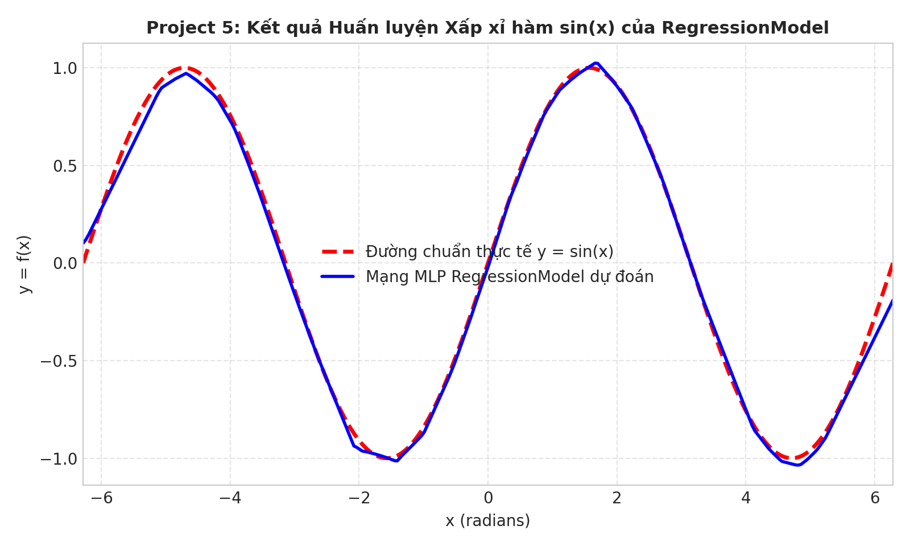

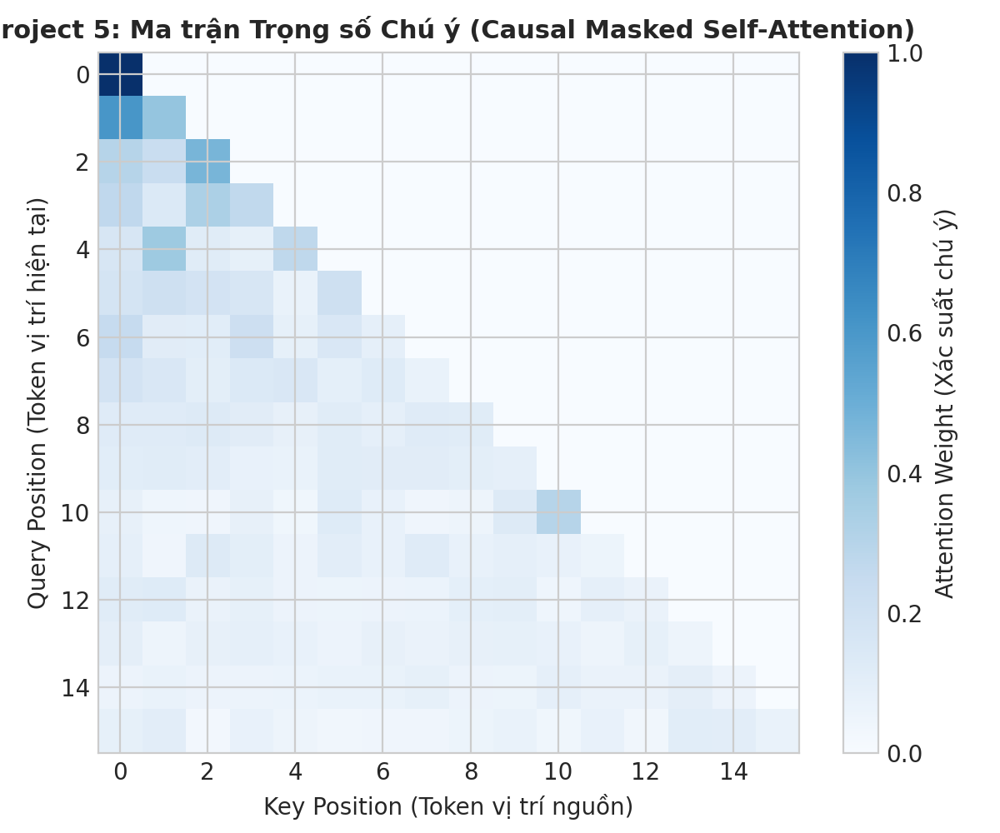

---

## 3. Phần II — Thiết kế Kịch bản Mở rộng & Đô thị Hợp nhất "Pacman Mega-City"

Để khắc phục tính rời rạc giữa các bài tập riêng lẻ và kiểm tra khả năng mở rộng quy mô lớn, tệp [`experiments/scenario.py`](./scenario.py) cung cấp 4 bộ sinh môi trường có kiểm soát hạt giống ngẫu nhiên (`seed`):

1. **`make_megacity(mode="route" | "food" | "arena", seed=1)` — Kịch bản Đô thị Hợp nhất `31x21` (`megacity_31x21.lay`):**
   - Một bản đồ đô thị dạng lưới mê cung bện (`braid = 0.35`, kích thước $31 \times 21 = 651$ ô, gồm $327$ ô đường đi tự do) đóng vai trò **môi trường xuyên suốt nối liền cả 4 Project**:
     - **Chế độ `route` (Project 1 — Exp A):** Điều hướng từ góc Đông-Bắc `(29, 19)` về góc Tây-Nam `(1, 1)` xuyên qua các dải địa hình đầm lầy (`~`, chi phí bước $= 5$, mật độ $25\%$).
     - **Chế độ `food` (Project 1 — Exp B):** Thu thập $k$ trạm thức ăn phân tán trong đô thị.
     - **Chế độ `arena` (Project 2, 3, 5 — Exp C, D, F, I):** Đấu trường đô thị đầy đủ thức ăn, $4$ viên năng lượng (`o`) ở 4 góc và **3 Ghosts** (`G`) tuần tra. Trên cùng bản đồ này, chúng tôi so sánh trực tiếp:
       1. Tác tử tìm kiếm cây đối kháng (`AlphaBeta-d2`, `Expectimax-d2` — Project 2),
       2. Tác tử học tăng cường chuyển giao không cần huấn luyện lại (**Zero-Shot Transfer** `ApproximateQAgent` từ `mediumClassic` sang `MegaCity` — Project 3),
       3. Tác tử mạng nơ-ron học bắt chước (`Imitation-MLP` và `Imitation-CNN` dùng hàm `models.Convolve` — Project 5).
2. **`make_search_maze(cells_w, cells_h, seed, braid=0.25, swamp_prob=0.25)`:** Sinh mê cung dùng thuật toán đệ quy quay lui kết hợp đục lỗ 25% tường cụt (`braid=0.25`, tạo nhiều chu trình để kiểm tra khả năng chọn đường ngắn nhất) và 25% ô đầm lầy (`~`, chi phí 5), mở rộng kích thước từ $31\times 31$ tới $151\times 151$ ($22{,}801$ ô).
3. **`make_classic_arena(half_w=20, half_h=10, num_ghosts=3, seed=1)`:** Sinh bản đồ đấu trường lớn $41\times 21$ ($861$ ô, lớn gấp **$3.91\times$** bản đồ `mediumClassic` $20\times 11 = 220$ ô), gồm các khối tường chữ nhật ngẫu nhiên (không đối xứng gương), 229 viên thức ăn, 4 viên năng lượng và 3 Ghosts.
4. **`make_gridworld(w, h, seed, wall_prob=0.25, pit_prob=0.08)`:** Sinh lưới MDP kích thước $w \times h$ ($10\times 10 \to 40\times 40$) với đích chính $+10$ tại `(w-1, h-1)`, lối ra phụ $+1$ tại `(0, h-1)`, $\approx 8\%$ hố bẫy $-10$, và $\approx 25\%$ ô tường `#`.

### Nguyên tắc Phương pháp Đo lường Nghiêm ngặt
Toàn bộ các góp ý về phương pháp đo đã được áp dụng triệt để trong mã nguồn thực nghiệm:
- **Định nghĩa nhất quán chỉ số "Số nút" (`nodes` / `expanded`):** Trong Project 1, `expanded` là số trạng thái lấy ra khỏi hàng đợi và gọi `problem.getSuccessors(state)`. Trong Project 2 ([`exp_multiagent.py`](./exp_multiagent.py)), `nodes` là số trạng thái con được sinh ra qua `GameState.generateSuccessor` (đếm bằng wrapper `_counting_gen` không sửa mã bài nộp).
- **Cách ly hoàn toàn việc đo thời gian khỏi đa tiến trình (`Pool`):** Thí nghiệm D (`run_pruning_sequential` trong [`exp_multiagent.py`](./exp_multiagent.py)) và các thí nghiệm G, H ([`exp_ml.py`](./exp_ml.py)) được chạy **tuần tự trên 1 luồng CPU duy nhất (`torch.set_num_threads(1)`)**, thực hiện **warm-up 3 lần** trước khi lấy **trung vị (median) của 5–15 lần chạy độc lập**.
- **Tách biệt chi phí đo hội tụ khỏi thời gian thuật toán:** Trong Thí nghiệm E ([`exp_rl.py`](./exp_rl.py)), `time_ms` chỉ bấm giờ thuần túy các bước cập nhật Bellman / hàng đợi ưu tiên, tách hoàn toàn khỏi hàm kiểm tra `metrics_vs_ref`; đồng thời đo cả số lần cập nhật trạng thái (`backups_to_tol`) và tổng số lần tính hàm $Q(s,a)$ (`q_evals_to_tol`).
- **Thống kê đầy đủ Độ lệch chuẩn (`± std`), Khoảng tin cậy Wilson 95% (`95% CI`) và Hệ số mũ Quy luật Lũy thừa ($\alpha$):** Toàn bộ số liệu dưới đây được trích xuất tự động từ [`experiments/summarize.py`](./summarize.py) trên các tệp CSV trong [`experiments/results/`](./results).

---

## 4. Phần III — Kết quả & Phân tích Chuyên sâu Các Thí nghiệm Mở rộng (A – I)

### 4.1. Thí nghiệm A: Mở rộng Kích thước Mê cung ($31^2 \to 151^2$) & Địa hình Đầm lầy

**Thiết lập ([`exp_search.py`](./exp_search.py), [`results/search_scaling.csv`](./results/search_scaling.csv) — 282 dòng):**  
Đánh giá 6 thuật toán (`DFS`, `BFS`, `UCS`, `A*-Manhattan`, `A*-Euclid`, `WA*-Manhattan (w=2.0)`) trên `bigMaze` gốc ($37\times 37$), đô thị `MegaCity-Route` ($31\times 21$, 3 seeds), và chuỗi mê cung $31\times 31$, $61\times 61$, $101\times 101$, $151\times 151$ (5 seeds mỗi kích thước) dưới 2 chế độ chi phí: **Unit Cost** (mọi bước $=1$) và **Swamp Cost** (`SwampProblem`: bước vào ô `~` tốn chi phí $5$, ô thường tốn $1$).

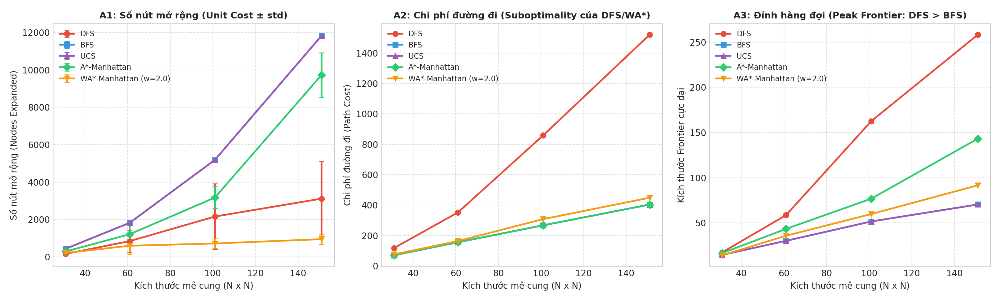

#### Bảng A1: Kết quả trên `bigMaze` ($37\times 37$), `MegaCity-Route` ($31\times 21$) và Mê cung $31\times 31 \to 151\times 151$ (Trung bình $\pm$ std)

| Bản đồ / Kích thước | Địa hình | Thuật toán | Chi phí đường đi ($\text{Cost} \pm \text{std}$) | Tỷ lệ $\text{Cost}/\text{Opt}$ | Số nút mở rộng ($\text{Expanded} \pm \text{std}$) | Độ phủ ô trống (%) | Đỉnh Frontier (`peak_frontier`) | Thời gian (ms) |
| :--- | :---: | :--- | :---: | :---: | :---: | :---: | :---: | :---: |
| **`bigMaze` (gốc)** ($37\times 37$) | `unit` | `DFS` | $210.0 \pm 0.0$ | $1.00\times$ | $390.0 \pm 0.0$ | $60.3\%$ | $38.0$ | $1.95$ |
| **`bigMaze` (gốc)** ($37\times 37$) | `unit` | `BFS` / `UCS` | $210.0 \pm 0.0$ | $1.00\times$ | $620.0 \pm 0.0$ | $95.8\%$ | $8.0$ | $3.13$ / $3.57$ |
| **`bigMaze` (gốc)** ($37\times 37$) | `unit` | `A*-Manhattan` | $210.0 \pm 0.0$ | $1.00\times$ | $549.0 \pm 0.0$ | $84.9\%$ | $12.0$ | $3.11$ |
| **`bigMaze` (gốc)** ($37\times 37$) | `unit` | `WA*-Manhattan (w=2.0)` | $210.0 \pm 0.0$ | $1.00\times$ | $510.0 \pm 0.0$ | $78.8\%$ | $16.0$ | $2.95$ |
| **`MegaCity-Route`** ($31\times 21$) | `unit` | `DFS` | $78.0 \pm 8.0$ | $1.59\times$ | $89.0 \pm 14.0$ | $27.2\%$ | $19.7$ | $0.43$ |
| **`MegaCity-Route`** ($31\times 21$) | `unit` | `BFS` / `UCS` | $50.0 \pm 6.9$ | $1.00\times$ | $313.7 \pm 20.0$ | $95.9\%$ | $13.3$ | $1.42$ / $1.67$ |
| **`MegaCity-Route`** ($31\times 21$) | `unit` | `A*-Manhattan` | $50.0 \pm 6.9$ | $1.00\times$ | $193.7 \pm 48.1$ | $59.4\%$ | $17.3$ | $1.08$ |
| **`MegaCity-Route`** ($31\times 21$) | `unit` | `WA*-Manhattan (w=2.0)` | $54.0 \pm 6.9$ | $1.08\times$ | $99.3 \pm 55.4$ | $30.3\%$ | $13.0$ | $0.58$ |
| **`MegaCity-Route`** ($31\times 21$) | `swamp` | `DFS` | $158.0 \pm 55.6$ | $2.36\times$ | $89.0 \pm 14.0$ | $27.2\%$ | $19.7$ | $0.45$ |
| **`MegaCity-Route`** ($31\times 21$) | `swamp` | `BFS` | $107.3 \pm 18.5$ | **$1.56\times$** | $313.7 \pm 20.0$ | $95.9\%$ | $13.3$ | $1.41$ |
| **`MegaCity-Route`** ($31\times 21$) | `swamp` | `UCS` | $68.7 \pm 6.1$ | $1.00\times$ | $260.7 \pm 40.9$ | $79.6\%$ | $17.7$ | $1.38$ |
| **`MegaCity-Route`** ($31\times 21$) | `swamp` | `A*-Manhattan` | $68.7 \pm 6.1$ | $1.00\times$ | $149.3 \pm 81.5$ | $45.6\%$ | $17.0$ | $0.88$ |
| **`MegaCity-Route`** ($31\times 21$) | `swamp` | `WA*-Manhattan (w=2.0)` | $68.7 \pm 6.1$ | **$1.00\times$** | **$89.0 \pm 23.3$** | **$27.3\%$** | $17.7$ | **$0.68$** |
| **Mê cung $31\times 31$** | `unit` | `DFS` / `BFS` / `A*-Manh` / `WA*` | $117.6$ / $70.4$ / $70.4$ / $76.0$ | $1.66\times$ / $1.00\times$ / $1.00\times$ / $1.08\times$ | $161.6$ / $437.4$ / $293.8$ / $211.0$ | $34.3\%$ / $92.6\%$ / $62.2\%$ / $44.6\%$ | $17.4$ / $14.6$ / $16.6$ / $14.2$ | $0.79$ / $2.01$ / $1.64$ / $1.28$ |
| **Mê cung $31\times 31$** | `swamp` | `DFS` / `BFS` / `UCS` / `A*-Manh` | $217.6$ / $118.4$ / $110.4$ / $110.4$ | $1.98\times$ / $1.08\times$ / $1.00\times$ / $1.00\times$ | $161.6$ / $437.4$ / $399.2$ / $290.6$ | $34.3\%$ / $92.6\%$ / $84.5\%$ / $61.5\%$ | $17.4$ / $14.6$ / $16.6$ / $15.8$ | $0.79$ / $1.99$ / $2.15$ / $1.63$ |
| **Mê cung $61\times 61$** | `unit` | `DFS` / `BFS` / `A*-Manh` / `WA*` | $352.0$ / $156.0$ / $156.0$ / $164.0$ | $2.25\times$ / $1.00\times$ / $1.00\times$ / $1.05\times$ | $842.6$ / $1822.0$ / $1210.4$ / $595.6$ | $44.6\%$ / $96.5\%$ / $64.1\%$ / $31.6\%$ | $58.6$ / $30.2$ / $43.4$ / $35.8$ | $6.57$ / $11.78$ / $10.24$ / $5.53$ |
| **Mê cung $61\times 61$** | `swamp` | `DFS` / `BFS` / `UCS` / `A*-Manh` | $715.2$ / $308.0$ / $280.8$ / $280.8$ | $2.73\times$ / $1.10\times$ / $1.00\times$ / $1.00\times$ | $842.6$ / $1822.0$ / $1749.2$ / $1443.2$ | $44.6\%$ / $96.5\%$ / $92.6\%$ / $76.5\%$ | $58.6$ / $30.2$ / $33.4$ / $40.4$ | $5.93$ / $12.67$ / $11.87$ / $14.08$ |
| **Mê cung $101\times 101$** | `unit` | `DFS` / `BFS` / `A*-Manh` / `WA*` | $858.4$ / $267.2$ / $267.2$ / $308.0$ | $3.19\times$ / $1.00\times$ / $1.00\times$ / $1.15\times$ | $2156.0$ / $5187.8$ / $3172.2$ / $716.4$ | $41.0\%$ / $98.5\%$ / $60.2\%$ / $13.6\%$ | $162.6$ / $51.6$ / $76.8$ / $59.8$ | $15.37$ / $28.87$ / $20.44$ / $4.74$ |
| **Mê cung $101\times 101$** | `swamp` | `DFS` / `BFS` / `UCS` / `A*-Manh` | $1726.4$ / $521.6$ / $426.4$ / $426.4$ | $3.96\times$ / $1.23\times$ / $1.00\times$ / $1.00\times$ | $2156.0$ / $5187.8$ / $4997.2$ / $4479.8$ | $41.0\%$ / $98.5\%$ / $94.9\%$ / $85.1\%$ | $162.6$ / $51.6$ / $64.6$ / $82.4$ | $14.72$ / $29.12$ / $32.27$ / $30.73$ |
| **Mê cung $151\times 151$** | `unit` | `DFS` | $1520.8 \pm 574.6$ | **$3.77\times$** | $3113.8 \pm 1987.9$ | $26.2\%$ | **$258.2$** | $22.22$ |
| **Mê cung $151\times 151$** | `unit` | `BFS` / `UCS` | $404.0 \pm 13.6$ | $1.00\times$ | $11824.6 \pm 59.4$ | $99.7\%$ | **$70.4$** | $64.56$ / $78.61$ |
| **Mê cung $151\times 151$** | `unit` | `A*-Euclid` | $404.0 \pm 13.6$ | $1.00\times$ | $10543.0 \pm 710.9$ | $88.9\%$ | $97.6$ | $75.76$ |
| **Mê cung $151\times 151$** | `unit` | `A*-Manhattan` | $404.0 \pm 13.6$ | $1.00\times$ | $9728.0 \pm 1193.7$ | $82.0\%$ | $143.2$ | $72.44$ |
| **Mê cung $151\times 151$** | `unit` | `WA*-Manhattan (w=2.0)` | $448.8 \pm 34.1$ | $1.11\times$ | **$946.2 \pm 264.8$** | **$8.0\%$** | $91.6$ | **$6.69$** |
| **Mê cung $151\times 151$** | `swamp` | `DFS` | $3189.6 \pm 1248.9$ | **$5.89\times$** | $3113.8 \pm 1987.9$ | $26.2\%$ | $258.2$ | $24.27$ |
| **Mê cung $151\times 151$** | `swamp` | `BFS` | $688.0 \pm 185.1$ | **$1.24\times$** | $11824.6 \pm 59.4$ | $99.7\%$ | $70.4$ | $67.24$ |
| **Mê cung $151\times 151$** | `swamp` | `UCS` | $548.0 \pm 92.3$ | $1.00\times$ | $11572.0 \pm 120.0$ | $97.6\%$ | $98.0$ | $82.06$ |
| **Mê cung $151\times 151$** | `swamp` | `A*-Manhattan` | $548.0 \pm 92.3$ | $1.00\times$ | $9647.8 \pm 1562.5$ | $81.4\%$ | $139.0$ | $67.94$ |
| **Mê cung $151\times 151$** | `swamp` | `WA*-Manhattan (w=2.0)` | $549.6 \pm 91.2$ | **$1.00\times$** | **$4862.6 \pm 4066.8$** | **$41.1\%$** | $148.2$ | **$34.16$** |

#### Các Phát hiện Khoa học Quan trọng từ Thí nghiệm A
1. **Quy luật lũy thừa theo kích thước lưới $N$ (Log-Log Scaling):** Hồi quy $\log(\text{Expanded}) = \alpha \log(N) + b$ trên các mê cung phẳng cho thấy `BFS` và `UCS` tăng bậc hai chặt chẽ với $\alpha = 2.08$ ($R^2 = 0.999$), `A*-Manhattan` có $\alpha = 2.20$ ($R^2 = 0.947$, do mê cung xoắn làm tăng tỷ lệ hành lang ngược hướng heuristic khi $N$ lớn), trong khi **`WA*-Manhattan (w=2.0)` có bậc tăng trưởng chỉ $\alpha = 1.01$** — tức tăng gần như **tuyến tính** theo $N$, giảm số nút mở rộng ở $151\times 151$ từ $9{,}728.0$ (A\*) xuống chỉ còn **$946.2$ nút ($8.0\%$ diện tích mê cung)** với sai số chi phí chỉ $1.11\times$ (Unit) và $1.003\times$ (Swamp: $549.6$ vs $548.0$).
2. **Giải thích hiện tượng nghịch trực giác: Tại sao `peak_frontier` của `DFS` lại lớn hơn `BFS` trong mê cung ($258.2$ so với $70.4$ ở $151\times 151$)?**
   - Trong lý thuyết cây trừu tượng có hệ số phân nhánh $b$ và độ sâu $d$, biên của BFS là $O(b^d)$ còn DFS là $O(b \cdot d)$. Tuy nhiên, trên **đồ thị mê cung phẳng 2D (`planar grid graph`)**, biên sóng (wavefront perimeter) của BFS tại bất kỳ bán kính Manhattan $r$ nào chỉ giao với một số hành lang dọc theo đường chéo, nên kích thước hàng đợi của BFS tỷ lệ tuyến tính với cạnh lưới: $\text{PeakFrontier}_{\text{BFS}} \sim N^{1.01}$ ($R^2 = 0.958$, đạt $70.4$ ở $151\times 151$).
   - Ngược lại, DFS đi sâu dọc theo một đường ngoằn ngoèo có chiều dài $L \sim O(N^2)$ (tới $1{,}520$ bước ở $151\times 151$). Do cơ chế Graph Search của CS188 chỉ đánh dấu `visited` khi `pop()`, tại mỗi ngã rẽ dọc theo hành lang dài $L$ (đặc biệt khi `braid=0.25` tạo nhiều ngã ba, ngã tư), các nhánh phụ chưa thăm đều được đẩy vào `Stack` và nằm chờ cho đến khi quay lui. Kết quả là $\text{PeakFrontier}_{\text{DFS}} \sim N^{1.73}$ ($R^2 = 0.880$, đạt **$258.2$ phần tử** ở $151\times 151$, gấp $3.67\times$ BFS).
3. **Sự suy biến của `BFS` và `DFS` trên địa hình đầm lầy trọng số (`swamp`):** Khi $25\%$ ô mang chi phí $5$, `BFS` chỉ tối ưu theo số bước nên đi xuyên qua đầm lầy, làm chi phí đội lên **$1.24\times$** ở $151\times 151$ ($688.0$ vs $548.0$) và **$1.56\times$** trên `MegaCity-Route` ($107.3$ vs $68.7$). `DFS` bị phạt tới **$5.89\times$** ở $151\times 151$ ($3{,}189.6$ vs $548.0$).

---

### 4.2. Thí nghiệm B: Bùng nổ Tổ hợp Multi-Food ($k = 3 \to 11$) & Tiền tính toán Khoảng cách + MST

**Thiết lập ([`exp_search.py`](./exp_search.py), [`results/search_food.csv`](./results/search_food.csv) — 90 dòng):**  
Trên mê cung $31\times 31$ với $k \in \{3, 5, 7, 9, 11\}$ viên thức ăn (3 seeds mỗi mức $k$, giới hạn $300{,}000$ nút hoặc $60\text{ s}$), không gian trạng thái phình lên $|S| = |\mathcal{V}| \cdot 2^k$. Chúng tôi đối chiếu 6 phương pháp:
1. `UCS`: Tìm kiếm chi phí đồng nhất không dùng heuristic.
2. `A* + foodHeuristic`: Hàm `foodHeuristic` gốc từ Project 1 Q7 (gọi `mazeDistance` trực tiếp khi gặp cặp thức ăn mới).
3. `A* + foodHeuristic (precomputed)`: Cùng công thức cực đại đường kính cặp thức ăn của `foodHeuristic`, nhưng **tiền tính toán một lần (precompute)** bản đồ khoảng cách BFS từ mọi viên thức ăn trước khi tìm kiếm (`precompute_ms`).
4. `A* + MSTHeuristic (precomputed)`: Heuristic **Cây khung nhỏ nhất (Minimum Spanning Tree — thuật toán Prim)** trên các viên thức ăn còn lại cộng khoảng cách mê cung từ Pacman tới viên thức ăn gần nhất (hoàn toàn admissible & consistent).
5. `WA* + MST (w=2.0)`: Trọng số $w=2.0$ kết hợp `MSTHeuristic (precomputed)`.
6. `ClosestDot (greedy)`: Tham lam ăn viên gần nhất liên tiếp (Project 1 Q8).

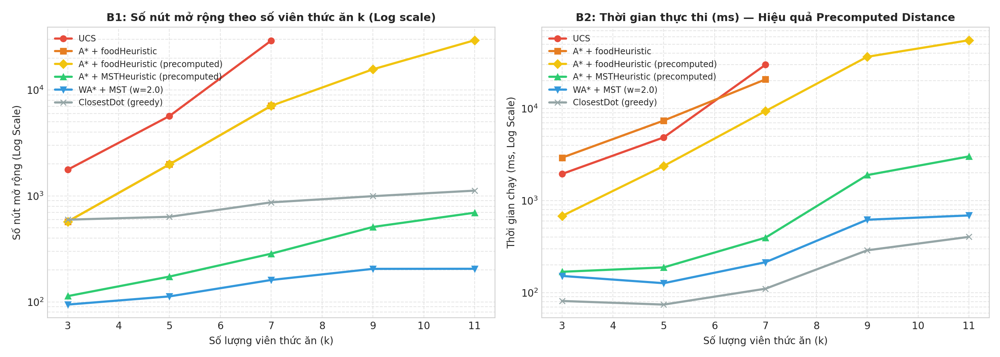

#### Bảng B1: Đối chiếu 6 Thuật toán trên Bài toán Multi-Food ($31\times 31$, $k = 3 \to 11$)

| Số viên $k$ | Thuật toán | Tỷ lệ giải (`solved`) | Số nút mở rộng ($\text{Expanded} \pm \text{std}$) | Tổng thời gian (`total_ms`) | Thời gian Precompute (`pre_ms`) | Tỷ lệ $\text{Cost}/\text{Opt}$ (Chi phí) |
| :---: | :--- | :---: | :---: | :---: | :---: | :---: |
| **$k = 3$** | `UCS` | `3/3` | $1{,}768.7 \pm 671.4$ | $1{,}945.0\text{ ms}$ | $0.0\text{ ms}$ | $1.00\times$ ($93.7$) |
| **$k = 3$** | `A* + foodHeuristic` | `3/3` | $572.7 \pm 475.4$ | $2{,}922.6\text{ ms}$ | $0.0\text{ ms}$ | $1.00\times$ ($93.7$) |
| **$k = 3$** | `A* + foodHeuristic (precomputed)` | `3/3` | $572.7 \pm 475.4$ | **$679.4\text{ ms}$** | $4.2\text{ ms}$ | $1.00\times$ ($93.7$) |
| **$k = 3$** | `A* + MSTHeuristic (precomputed)` | `3/3` | **$113.3 \pm 53.7$** | **$168.3\text{ ms}$** | $4.4\text{ ms}$ | $1.00\times$ ($93.7$) |
| **$k = 3$** | `WA* + MST (w=2.0)` | `3/3` | **$94.3 \pm 45.4$** | $151.7\text{ ms}$ | $4.7\text{ ms}$ | $1.00\times$ ($93.7$) |
| **$k = 3$** | `ClosestDot (greedy)` | `3/3` | $597.0 \pm 258.0$ | $81.0\text{ ms}$ | $0.0\text{ ms}$ | $1.00\times$ ($93.7$) |
| **$k = 5$** | `UCS` | `3/3` | $5{,}675.3 \pm 4{,}860.8$ | $4{,}853.6\text{ ms}$ | $0.0\text{ ms}$ | $1.00\times$ ($108.7$) |
| **$k = 5$** | `A* + foodHeuristic` | `3/3` | $1{,}985.7 \pm 2{,}669.5$ | $7{,}392.6\text{ ms}$ | $0.0\text{ ms}$ | $1.00\times$ ($108.7$) |
| **$k = 5$** | `A* + foodHeuristic (precomputed)` | `3/3` | $1{,}985.7 \pm 2{,}669.5$ | **$2{,}373.0\text{ ms}$** | $6.8\text{ ms}$ | $1.00\times$ ($108.7$) |
| **$k = 5$** | `A* + MSTHeuristic (precomputed)` | `3/3` | **$173.3 \pm 103.5$** | **$187.8\text{ ms}$** | $7.2\text{ ms}$ | $1.00\times$ ($108.7$) |
| **$k = 5$** | `WA* + MST (w=2.0)` | `3/3` | **$112.7 \pm 63.2$** | $126.5\text{ ms}$ | $3.4\text{ ms}$ | $1.00\times$ ($108.7$) |
| **$k = 5$** | `ClosestDot (greedy)` | `3/3` | $635.7 \pm 337.4$ | $74.1\text{ ms}$ | $0.0\text{ ms}$ | $1.00\times$ ($108.7$) |
| **$k = 7$** | `UCS` | `3/3` | $29{,}223.3 \pm 5{,}653.3$ | $29{,}867.0\text{ ms}$ | $0.0\text{ ms}$ | $1.00\times$ ($139.0$) |
| **$k = 7$** | `A* + foodHeuristic` | `3/3` | $7{,}084.7 \pm 5{,}908.6$ | $20{,}702.2\text{ ms}$ | $0.0\text{ ms}$ | $1.00\times$ ($139.0$) |
| **$k = 7$** | `A* + foodHeuristic (precomputed)` | `3/3` | $7{,}084.7 \pm 5{,}908.6$ | **$9{,}371.5\text{ ms}$** | $10.0\text{ ms}$ | $1.00\times$ ($139.0$) |
| **$k = 7$** | `A* + MSTHeuristic (precomputed)` | `3/3` | **$285.0 \pm 152.6$** | **$395.0\text{ ms}$** | $11.6\text{ ms}$ | $1.00\times$ ($139.0$) |
| **$k = 7$** | `WA* + MST (w=2.0)` | `3/3` | **$161.0 \pm 58.9$** | $213.8\text{ ms}$ | $12.7\text{ ms}$ | $1.00\times$ ($139.0$) |
| **$k = 7$** | `ClosestDot (greedy)` | `3/3` | $869.7 \pm 216.4$ | $110.2\text{ ms}$ | $0.0\text{ ms}$ | $1.10\times$ ($153.7$) |
| **$k = 9$** | `UCS` | `0/3` | $300{,}000.0 \pm 0.0$ | $60{,}004.4\text{ ms}$ | $0.0\text{ ms}$ | `TIMEOUT` |
| **$k = 9$** | `A* + foodHeuristic` | `0/3` | $300{,}000.0 \pm 0.0$ | $60{,}013.6\text{ ms}$ | $0.0\text{ ms}$ | `TIMEOUT` |
| **$k = 9$** | `A* + foodHeuristic (precomputed)` | `2/3` | $110{,}445.7 \pm 164{,}159.8$ | $44{,}304.2\text{ ms}$ | $9.1\text{ ms}$ | $1.00\times$ ($127.5$, 2 seeds) |
| **$k = 9$** | `A* + MSTHeuristic (precomputed)` | **`3/3`** | **$509.7 \pm 564.3$** | **$1{,}889.7\text{ ms}$** | $29.1\text{ ms}$ | **$1.00\times$ ($159.7$)** |
| **$k = 9$** | `WA* + MST (w=2.0)` | **`3/3`** | **$205.0 \pm 131.6$** | **$619.0\text{ ms}$** | $48.3\text{ ms}$ | $1.01\times$ ($161.0$) |
| **$k = 9$** | `ClosestDot (greedy)` | `3/3` | $995.0 \pm 362.3$ | $287.9\text{ ms}$ | $0.0\text{ ms}$ | $1.08\times$ ($176.0$) |
| **$k = 11$** | `UCS` | `0/3` | $300{,}000.0 \pm 0.0$ | $60{,}030.7\text{ ms}$ | $0.0\text{ ms}$ | `TIMEOUT` |
| **$k = 11$** | `A* + foodHeuristic` | `0/3` | $300{,}000.0 \pm 0.0$ | $60{,}031.3\text{ ms}$ | $0.0\text{ ms}$ | `TIMEOUT` |
| **$k = 11$** | `A* + foodHeuristic (precomputed)` | `1/3` | $209{,}826.0 \pm 156{,}185.9$ | $58{,}387.9\text{ ms}$ | $6.1\text{ ms}$ | $1.00\times$ ($128.0$, seed 1) |
| **$k = 11$** | `A* + MSTHeuristic (precomputed)` | **`3/3`** | **$694.7 \pm 481.6$** | **$3{,}015.4\text{ ms}$** | $35.6\text{ ms}$ | **$1.00\times$ ($178.3$)** |
| **$k = 11$** | `WA* + MST (w=2.0)` | **`3/3`** | **$205.3 \pm 74.1$** | **$689.0\text{ ms}$** | $69.0\text{ ms}$ | **$1.01\times$ ($179.0$)** |
| **$k = 11$** | `ClosestDot (greedy)` | `3/3` | $1{,}122.0 \pm 361.0$ | $403.2\text{ ms}$ | $0.0\text{ ms}$ | $1.16\times$ ($209.7$) |

#### Phân tích Chuyên sâu Thí nghiệm B
1. **Giải thích tại sao `A* + foodHeuristic` (không precompute) mở rộng ít nút hơn nhưng lại chạy chậm hơn `UCS` ở $k$ nhỏ ($k=3, 5$):**
   - Ở $k=3$, `A* + foodHeuristic` chỉ mở rộng $572.7$ nút so với $1{,}768.7$ nút của `UCS` (giảm $3.09\times$ số nút), nhưng lại mất $2{,}922.6\text{ ms}$ so với $1{,}945.0\text{ ms}$ của `UCS`. Nguyên nhân là mỗi lần `foodHeuristic` truy vấn một cặp vị trí `(pos, food)` chưa có trong cache, nó khởi tạo một `PositionSearchProblem` và chạy tìm kiếm BFS đầy đủ trên mê cung $31\times 31$.
   - Khi ta **tiền tính toán (precompute)** bảng khoảng cách BFS một lần từ $k$ viên thức ăn (chỉ mất **$4.2\text{ ms} \to 10.0\text{ ms}$**), `A* + foodHeuristic (precomputed)` giữ nguyên chính xác số nút mở rộng ($572.7$ ở $k=3$; $7{,}084.7$ ở $k=7$) nhưng thời gian giảm **$4.3\times$ ở $k=3$ ($679.4\text{ ms}$ — nhanh hơn UCS $2.86\times$)** và giải được `2/3` seeds ở $k=9$, `1/3` seeds ở $k=11$ ($29{,}478$ nút ở seed 1).
2. **Đột phá với `A* + MSTHeuristic (precomputed)` và `WA* + MST (w=2.0)`:**
   - `foodHeuristic` chỉ xét khoảng cách giữa **2 viên thức ăn xa nhất** nên đánh giá quá thấp chi phí khi còn $k=9, 11$ viên phân tán khắp bản đồ. Thay bằng **trọng số cây khung nhỏ nhất (Prim's MST)** qua toàn bộ các viên thức ăn còn lại giúp cận dưới sát với lộ trình TSP thực tế hơn rất nhiều mà vẫn đảm bảo 100% tính chấp nhận được (admissible).
   - Ở $k=11$, `A* + MSTHeuristic (precomputed)` giải **100% (`3/3`) mẫu** với trung bình chỉ **$694.7 \pm 481.6$ nút mở rộng** (ít hơn cả `ClosestDot` tham lam $1{,}122.0$ nút!) trong **$3.02\text{ s}$**, đạt lộ trình tối ưu tuyệt đối ($1.00\times$, chi phí $178.3$). Với `WA* + MST (w=2.0)`, số nút giảm xuống chỉ còn **$205.3 \pm 74.1$ nút** ($689.0\text{ ms}$) với sai số chi phí chỉ $1.01\times$ ($179.0$).

---

### 4.3. Thí nghiệm C: Đấu trường Đối kháng 3 Ghosts — Kiểm chứng Giả thuyết Khoảng cách Mê cung & Giá trị Kết thúc Hữu hạn

**Thiết lập ([`exp_multiagent.py`](./exp_multiagent.py), [`results/multiagent_games.csv`](./results/multiagent_games.csv) — 288 ván đấu):**  
Đánh giá 6 tác tử (`Reflex`, `AlphaBeta-d2 (scoreEval)`, `AlphaBeta-d2 (betterEval)`, `Expectimax-d2 (betterEval)`, `AlphaBeta-d2 (mazeEval)`, `Expectimax-d2 (mazeEval)`) trên 3 bản đồ (`mediumClassic 20x11`, `MegaCity 31x21`, `Arena 41x21`) trước 2 loại Ghost (`RandomGhost` và `DirectionalGhost`), mỗi ô chạy **8 seeds** (tổng $3 \times 6 \times 2 \times 8 = 288$ ván, giới hạn `MAX_MOVES = 600`).

#### Thiết kế Thực nghiệm Kiểm chứng 2 Giả thuyết Phản biện
1. **Giả thuyết 1 (Nguyên nhân kẹt vòng lặp Timeout 600 nước):** Phải chăng Pacman bị kẹt trên `Arena` / `MegaCity` là do hàm `betterEvaluationFunction` dùng khoảng cách Manhattan xuyên tường (khiến Pacman đứng bên này bức tường dao động qua lại vì tưởng viên thức ăn bên kia bức tường ở gần)?
2. **Giả thuyết 2 (Sự bi quan của Expectimax với $-\infty$):** Hàm `betterEvaluationFunction` gốc trả về `float("-inf")` khi thua (`isLose()`). Do đó trong `Expectimax`, chỉ cần **1 nhánh xác suất nhỏ** của Ghost dẫn tới thua là toàn bộ kỳ vọng $\frac{1}{|\mathcal{A}|}\sum V(s') = -\infty$, khiến `Expectimax` bi quan về cái chết y hệt `AlphaBeta`!
3. **Giải pháp Kiểm chứng (`mazeBetterEvaluationFunction` — `mazeEval`):**
   - Thay thế `±inf` ở trạng thái kết thúc bằng **giá trị hữu hạn $\pm 10{,}000 + \text{score}$** để `Expectimax` cân đo đúng xác suất rủi ro.
   - Thay khoảng cách Manhattan bằng **khoảng cách mê cung thực tế (`get_wall_dist_map` — BFS tiền tính toán một lần cho mỗi bản đồ, tra cứu $O(1)$ qua thuộc tính `walls._dist_map`)**.

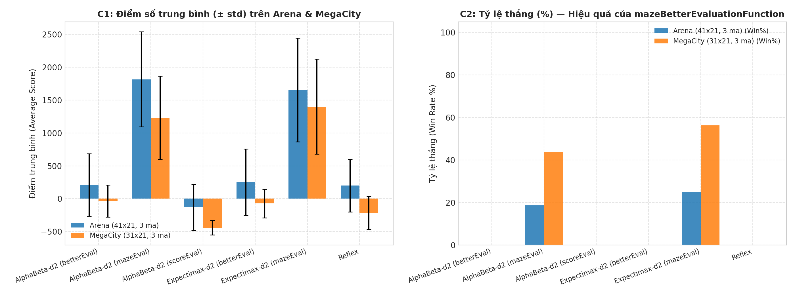

#### Bảng C1: Kết quả Thi đấu Đối kháng trên 3 Bản đồ (8 ván/ô, kèm Wilson 95% CI & Phân tách Win/Died/Timeout)

| Bản đồ | Loại Ghost | Tác tử Pacman | KQ (`W/D/T`) | Tỷ lệ thắng & Wilson 95% CI | Điểm số ($\text{Mean} \pm \text{std}$) | Thức ăn dọn sạch (%) | Số nước đi (`moves`) | Nút/nước (`nodes`) | Thời gian (`ms/mv`) |
| :--- | :---: | :--- | :---: | :---: | :---: | :---: | :---: | :---: | :---: |
| **`mediumClassic`** ($20\times 11$, 2 ma) | `Random` | `Reflex` | `6/2/0` | **$75.0\%$** `[40.9, 92.9]` | $1220.6 \pm 783.4$ | $87.0 \pm 24.5\%$ | $173.1$ | $3.3$ | **$1.12$** |
| **`mediumClassic`** ($20\times 11$, 2 ma) | `Random` | `AlphaBeta-d2 (scoreEval)` | `0/4/4` | $0.0\%$ `[0.0, 32.4]` | $453.8 \pm 426.8$ | $76.7 \pm 24.2\%$ | $490.0$ | $79.5$ | $19.42$ |
| **`mediumClassic`** ($20\times 11$, 2 ma) | `Random` | `AlphaBeta-d2 (betterEval)` | `7/1/0` | $87.5\%$ `[52.9, 97.8]` | $1777.4 \pm 415.2$ | $99.9 \pm 0.4\%$ | $241.4$ | $74.8$ | $33.88$ |
| **`mediumClassic`** ($20\times 11$, 2 ma) | `Random` | `Expectimax-d2 (betterEval)` | `5/3/0` | $62.5\%$ `[30.6, 86.3]` | $1484.4 \pm 658.5$ | $99.0 \pm 2.1\%$ | $250.6$ | $101.5$ | $28.30$ |
| **`mediumClassic`** ($20\times 11$, 2 ma) | `Random` | `AlphaBeta-d2 (mazeEval)` | **`8/0/0`** | **$100.0\%$** `[67.6, 100.0]` | **$2018.0 \pm 147.5$** | **$100.0 \pm 0.0\%$** | $152.0$ | $78.9$ | $19.27$ |
| **`mediumClassic`** ($20\times 11$, 2 ma) | `Random` | `Expectimax-d2 (mazeEval)` | **`8/0/0`** | **$100.0\%$** `[67.6, 100.0]` | **$2021.6 \pm 111.2$** | **$100.0 \pm 0.0\%$** | $148.4$ | $111.3$ | $24.96$ |
| **`mediumClassic`** ($20\times 11$, 2 ma) | `Directional` | `Reflex` | `2/6/0` | $25.0\%$ `[7.1, 59.1]` | $754.6 \pm 653.9$ | $79.3 \pm 21.7\%$ | $139.1$ | $3.3$ | $1.20$ |
| **`mediumClassic`** ($20\times 11$, 2 ma) | `Directional` | `AlphaBeta-d2 (scoreEval)` | `0/8/0` | $0.0\%$ `[0.0, 32.4]` | $330.1 \pm 268.2$ | $65.6 \pm 24.4\%$ | $156.1$ | $73.2$ | $18.74$ |
| **`mediumClassic`** ($20\times 11$, 2 ma) | `Directional` | `AlphaBeta-d2 (betterEval)` | `4/4/0` | $50.0\%$ `[21.5, 78.5]` | $1355.0 \pm 592.1$ | $90.8 \pm 12.7\%$ | $151.2$ | $71.5$ | $25.58$ |
| **`mediumClassic`** ($20\times 11$, 2 ma) | `Directional` | `Expectimax-d2 (betterEval)` | `6/2/0` | **$75.0\%$** `[40.9, 92.9]` | **$1645.2 \pm 430.9$** | $95.6 \pm 9.5\%$ | $157.2$ | $102.8$ | $22.40$ |
| **`mediumClassic`** ($20\times 11$, 2 ma) | `Directional` | `AlphaBeta-d2 (mazeEval)` | `4/4/0` | $50.0\%$ `[21.5, 78.5]` | $1378.2 \pm 529.4$ | $94.8 \pm 6.9\%$ | $141.8$ | $72.4$ | $16.90$ |
| **`mediumClassic`** ($20\times 11$, 2 ma) | `Directional` | `Expectimax-d2 (mazeEval)` | `3/5/0` | $37.5\%$ `[13.7, 69.4]` | $1302.6 \pm 619.7$ | $88.9 \pm 11.6\%$ | $134.9$ | $107.0$ | $24.76$ |
| **`MegaCity`** ($31\times 21$, 3 ma) | `Random` | `Reflex` | `0/1/7` | $0.0\%$ `[0.0, 32.4]` | $-114.5 \pm 221.4$ | $33.8 \pm 13.9\%$ | $597.0$ | $3.1$ | $2.70$ |
| **`MegaCity`** ($31\times 21$, 3 ma) | `Random` | `AlphaBeta-d2 (scoreEval)` | `0/1/7` | $0.0\%$ `[0.0, 32.4]` | $-449.1 \pm 81.6$ | $13.0 \pm 6.5\%$ | $564.1$ | $110.4$ | $52.60$ |
| **`MegaCity`** ($31\times 21$, 3 ma) | `Random` | `AlphaBeta-d2 (betterEval)` | `0/0/8` | $0.0\%$ `[0.0, 32.4]` | $-47.5 \pm 146.3$ | $36.5 \pm 12.5\%$ | $600.0$ | $87.5$ | $50.14$ |
| **`MegaCity`** ($31\times 21$, 3 ma) | `Random` | `Expectimax-d2 (betterEval)` | `0/0/8` | $0.0\%$ `[0.0, 32.4]` | $-62.5 \pm 157.0$ | $35.3 \pm 13.2\%$ | $600.0$ | $114.7$ | $63.93$ |
| **`MegaCity`** ($31\times 21$, 3 ma) | `Random` | `AlphaBeta-d2 (mazeEval)` | **`7/0/1`** | **$87.5\%$** `[52.9, 97.8]` | **$1693.0 \pm 361.2$** | **$99.7 \pm 0.9\%$** | $510.8$ | $84.5$ | $49.20$ |
| **`MegaCity`** ($31\times 21$, 3 ma) | `Random` | `Expectimax-d2 (mazeEval)` | **`7/0/1`** | **$87.5\%$** `[52.9, 97.8]` | **$1757.0 \pm 309.6$** | **$99.6 \pm 1.2\%$** | $470.5$ | $112.2$ | $59.85$ |
| **`MegaCity`** ($31\times 21$, 3 ma) | `Directional` | `Reflex` | `0/7/1` | $0.0\%$ `[0.0, 32.4]` | $-318.4 \pm 249.1$ | $22.1 \pm 12.6\%$ | $289.6$ | $3.1$ | $2.66$ |
| **`MegaCity`** ($31\times 21$, 3 ma) | `Directional` | `AlphaBeta-d2 (scoreEval)` | `0/7/1` | $0.0\%$ `[0.0, 32.4]` | $-432.9 \pm 140.8$ | $23.0 \pm 10.7\%$ | $339.1$ | $71.5$ | $32.30$ |
| **`MegaCity`** ($31\times 21$, 3 ma) | `Directional` | `AlphaBeta-d2 (betterEval)` | `0/7/1` | $0.0\%$ `[0.0, 32.4]` | $-22.8 \pm 326.3$ | $37.8 \pm 14.9\%$ | $302.8$ | $71.7$ | $39.79$ |
| **`MegaCity`** ($31\times 21$, 3 ma) | `Directional` | `Expectimax-d2 (betterEval)` | `0/7/1` | $0.0\%$ `[0.0, 32.4]` | $-84.0 \pm 276.5$ | $37.9 \pm 15.0\%$ | $315.2$ | $94.5$ | $51.81$ |
| **`MegaCity`** ($31\times 21$, 3 ma) | `Directional` | `AlphaBeta-d2 (mazeEval)` | `0/8/0` | $0.0\%$ `[0.0, 32.4]` | **$770.9 \pm 502.0$** | **$64.4 \pm 21.6\%$** | $257.9$ | $82.8$ | $49.27$ |
| **`MegaCity`** ($31\times 21$, 3 ma) | `Directional` | `Expectimax-d2 (mazeEval)` | **`2/6/0`** | **$25.0\%$** `[7.1, 59.1]` | **$1045.8 \pm 858.5$** | **$75.6 \pm 28.2\%$** | $364.2$ | $104.7$ | $56.57$ |
| **`Arena`** ($41\times 21$, 3 ma) | `Random` | `Reflex` | `0/0/8` | $0.0\%$ `[0.0, 32.4]` | $312.5 \pm 293.2$ | $38.7 \pm 11.3\%$ | $600.0$ | $3.1$ | $3.67$ |
| **`Arena`** ($41\times 21$, 3 ma) | `Random` | `AlphaBeta-d2 (scoreEval)` | `0/0/8` | $0.0\%$ `[0.0, 32.4]` | $-173.8 \pm 306.0$ | $13.2 \pm 5.6\%$ | $600.0$ | $145.1$ | $99.28$ |
| **`Arena`** ($41\times 21$, 3 ma) | `Random` | `AlphaBeta-d2 (betterEval)` | `0/1/7` | $0.0\%$ `[0.0, 32.4]` | $358.4 \pm 465.3$ | $37.4 \pm 12.8\%$ | $564.1$ | $119.0$ | $100.71$ |
| **`Arena`** ($41\times 21$, 3 ma) | `Random` | `Expectimax-d2 (betterEval)` | `0/0/8` | $0.0\%$ `[0.0, 32.4]` | $418.8 \pm 398.8$ | $40.2 \pm 11.6\%$ | $600.0$ | $163.0$ | $145.79$ |
| **`Arena`** ($41\times 21$, 3 ma) | `Random` | `AlphaBeta-d2 (mazeEval)` | **`3/0/5`** | **$37.5\%$** `[13.7, 69.4]` | **$2215.2 \pm 470.2$** | **$99.4 \pm 0.6\%$** | $584.8$ | $106.0$ | $85.53$ |
| **`Arena`** ($41\times 21$, 3 ma) | `Random` | `Expectimax-d2 (mazeEval)` | **`4/0/4`** | **$50.0\%$** `[21.5, 78.5]` | **$2076.6 \pm 365.2$** | **$99.5 \pm 0.6\%$** | $588.4$ | $160.1$ | $130.36$ |
| **`Arena`** ($41\times 21$, 3 ma) | `Directional` | `Reflex` | `0/8/0` | $0.0\%$ `[0.0, 32.4]` | $85.8 \pm 474.9$ | $29.5 \pm 19.8\%$ | $234.2$ | $3.2$ | $4.08$ |
| **`Arena`** ($41\times 21$, 3 ma) | `Directional` | `AlphaBeta-d2 (scoreEval)` | `0/8/0` | $0.0\%$ `[0.0, 32.4]` | $-90.4 \pm 403.0$ | $22.4 \pm 18.6\%$ | $161.6$ | $97.1$ | $66.30$ |
| **`Arena`** ($41\times 21$, 3 ma) | `Directional` | `AlphaBeta-d2 (betterEval)` | `0/8/0` | $0.0\%$ `[0.0, 32.4]` | $57.9 \pm 462.0$ | $26.5 \pm 21.6\%$ | $223.4$ | $99.1$ | $83.52$ |
| **`Arena`** ($41\times 21$, 3 ma) | `Directional` | `Expectimax-d2 (betterEval)` | `0/7/1` | $0.0\%$ `[0.0, 32.4]` | $87.9 \pm 570.4$ | $25.4 \pm 23.0\%$ | $233.4$ | $153.7$ | $129.70$ |
| **`Arena`** ($41\times 21$, 3 ma) | `Directional` | `AlphaBeta-d2 (mazeEval)` | `0/5/3` | $0.0\%$ `[0.0, 32.4]` | **$1416.8 \pm 729.5$** | **$74.6 \pm 27.8\%$** | $437.0$ | $105.5$ | $88.54$ |
| **`Arena`** ($41\times 21$, 3 ma) | `Directional` | `Expectimax-d2 (mazeEval)` | `0/6/2` | $0.0\%$ `[0.0, 32.4]` | **$1232.9 \pm 895.9$** | **$65.2 \pm 30.2\%$** | $362.1$ | $151.3$ | $124.94$ |

#### Kết luận Khoa học từ Thí nghiệm C
1. **Xác nhận hoàn toàn giả thuyết về Khoảng cách Mê cung (`mazeEval`) vs Manhattan (`betterEval`):**
   - Trên `MegaCity (31x21)` trước `RandomGhost`, cả `AlphaBeta-d2 (betterEval)` và `Expectimax-d2 (betterEval)` đều bị **timeout `8/8` ván ở nước thứ 600** với chỉ $35.3\%\text{–}36.5\%$ thức ăn được ăn (điểm âm $-47.5$ và $-62.5$). Khi đổi sang `mazeBetterEvaluationFunction` (khoảng cách BFS thực tế + giá trị kết thúc hữu hạn $\pm 10{,}000$), tỷ lệ thắng vọt từ **$0\%$ lên $87.5\%$ (`7/8` ván thắng)**, tỷ lệ dọn thức ăn đạt **$99.7\%$** và điểm trung bình tăng hơn **+1.750 điểm** (lên $1{,}693.0$ và $1{,}757.0$)!
   - Tương tự trên `Arena (41x21)` trước `RandomGhost`, `betterEval` timeout 7–8/8 ván ở mức $\sim 38\%$ thức ăn, trong khi `mazeEval` dọn sạch **$99.4\%\text{–}99.5\%$ thức ăn** trên toàn bộ 8 ván (thắng hoàn toàn $37.5\%\text{–}50.0\%$ số ván trong $<600$ nước, và các ván chạm mốc 600 nước đều đã ăn $227/229$ viên thức ăn, **0 lần chết**, điểm đạt **$2{,}076.6\text{–}2{,}215.2$**).
2. **Xác nhận hiệu ứng Giá trị Kết thúc Hữu hạn ($\pm 10{,}000$) đối với `Expectimax`:**
   - Khi đối đầu 3 `DirectionalGhost` hung hãn trên `MegaCity (31x21)`, với `betterEval` ($\pm\infty$), `Expectimax-d2` và `AlphaBeta-d2` cho kết quả gần như giống hệt nhau (cùng thua 7/8, timeout 1/8, ăn $37.8\%\text{–}37.9\%$ thức ăn) vì $-\infty$ làm suy biến phép lấy kỳ vọng của Expectimax. Khi dùng `mazeEval` ($\pm 10{,}000$), `Expectimax-d2 (mazeEval)` chấp nhận rủi ro hợp lý để thoát vòng vây, đạt **tỷ lệ thắng $25.0\%$ (`2/8` ván thắng hoàn toàn trước 3 DirectionalGhosts!)**, ăn **$75.6\%$ thức ăn** và ghi **$1{,}045.8 \pm 858.5$ điểm** (so với $0\%$ thắng, $64.4\%$ thức ăn, $770.9$ điểm của `AlphaBeta-d2 (mazeEval)`).
3. **Bình luận về hiệu năng của `ReflexAgent` trên `mediumClassic`:**
   - Trước `RandomGhost` trên `mediumClassic`, `ReflexAgent` thắng tới **$75.0\%$ (`6/8` ván)** với tốc độ **$1.12\text{ ms/nước}$** (nhanh gấp **$17\times\text{–}30\times$** so với `AlphaBeta-d2` ở $19.27\text{–}33.88\text{ ms/nước}$). Điều này cho thấy khi Ghost di chuyển ngẫu nhiên trên bản đồ nhỏ ít ngõ cụt, luật phản xạ 1 bước đã đủ tốt; lợi thế của tìm kiếm cây độ sâu 2 (`AlphaBeta`/`Expectimax` + `mazeEval`) chỉ thực sự vượt trội khi đối đầu `DirectionalGhost` ($50\%\text{–}75\%$ thắng so với $25\%$ của `Reflex`) hoặc trên các mê cung phức hợp 3 Ghosts (`MegaCity`, `Arena`).

---

### 4.4. Thí nghiệm D: Hiệu quả Cắt tỉa Alpha-Beta & Sắp xếp Nước đi (Move Ordering)

**Thiết lập ([`exp_multiagent.py`](./exp_multiagent.py), [`results/multiagent_pruning.csv`](./results/multiagent_pruning.csv) — 70 trạng thái):**  
Để loại bỏ hoàn toàn nhiễu tranh chấp CPU, `run_pruning_sequential` chạy trên **1 tiến trình đơn duy nhất** sau khi `Pool` đóng lại. Trên mỗi trạng thái lấy mẫu từ ván đấu thật, từng thuật toán (`Minimax`, `AlphaBeta`, `OrderedAlphaBeta`, `Expectimax`) được chạy 1 lần warm-up rồi lấy **trung vị (median) của 5 lần đo liên tiếp** ($d=2$) hoặc 3 lần ($d=3$). `OrderedAlphaBetaAgent` sắp xếp các nước đi của Pacman theo giá trị `evaluationFunction` ở độ sâu 1 (1-ply move ordering) để ưu tiên khám phá nhánh tốt nhất trước.

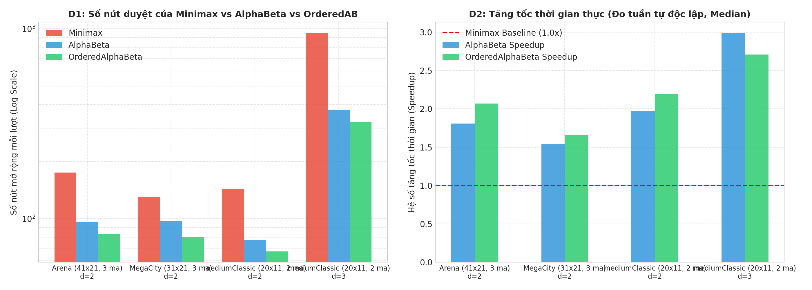

#### Bảng D1: So sánh Số nút (`generateSuccessor`) và Tốc độ Thực thi Tuần tự

| Bản đồ & Số tác tử | Độ sâu $d$ (Số tầng ply) | Số trạng thái mẫu | `Minimax` (Nút / ms) | `AlphaBeta` Chuẩn (Nút / ms) | Tỷ lệ cắt nút AB ($\pm\text{std}$) | Tăng tốc AB (`Speedup`) | `OrderedAlphaBeta` (Nút / ms) | Tỷ lệ cắt nút OrdAB ($\pm\text{std}$) | Tăng tốc OrdAB | Khớp nước đi (`match`) |
| :--- | :---: | :---: | :---: | :---: | :---: | :---: | :---: | :---: | :---: | :---: |
| **`mediumClassic`** (1P + 2G) | $d=2$ (6 ply) | $20$ | $143.8$ / $53.3\text{ ms}$ | $77.2$ / $28.5\text{ ms}$ | $30.7 \pm 21.8\%$ | **$1.97 \pm 1.63\times$** | **$67.3$** / $26.1\text{ ms}$ | **$39.9 \pm 18.0\%$** | **$2.20\times$** | **$100.0\%$** |
| **`mediumClassic`** (1P + 2G) | $d=3$ (9 ply) | $10$ | $952.2$ / $352.9\text{ ms}$ | $375.0$ / $137.3\text{ ms}$ | $44.8 \pm 24.0\%$ | **$2.98 \pm 2.41\times$** | **$323.4$** / $126.7\text{ ms}$ | **$56.8 \pm 10.9\%$** | **$2.71\times$** | **$100.0\%$** |
| **`MegaCity 31x21`** (1P + 3G) | $d=2$ (8 ply) | $20$ | $129.9$ / $66.3\text{ ms}$ | $96.8$ / $49.1\text{ ms}$ | $20.7 \pm 15.8\%$ | **$1.54 \pm 0.56\times$** | **$79.8$** / $41.9\text{ ms}$ | **$28.0 \pm 20.3\%$** | **$1.66\times$** | **$100.0\%$** |
| **`Arena 41x21`** (1P + 3G) | $d=2$ (8 ply) | $20$ | $174.8$ / $133.5\text{ ms}$ | $96.2$ / $73.6\text{ ms}$ | $27.6 \pm 24.4\%$ | **$1.81 \pm 1.06\times$** | **$82.7$** / $65.0\text{ ms}$ | **$36.9 \pm 22.7\%$** | **$2.07\times$** | **$100.0\%$** |

- **Nhận xét:** Khi đo độc lập không tranh chấp tiến trình, tỷ lệ tăng tốc thời gian thực (`Speedup`) bám sát tỷ lệ giảm nút mở rộng. Bổ sung **Move Ordering 1-ply (`OrderedAlphaBeta`)** nâng tỷ lệ cắt tỉa từ $30.7\% \to 39.9\%$ ở $d=2$ và từ **$44.8\% \to 56.8\%$** ở $d=3$ trên `mediumClassic` (giảm số nút từ $952.2$ xuống $323.4$ nút/nước) trong khi vẫn bảo toàn **100.0% quyết định nước đi của Minimax**.

---

### 4.5. Thí nghiệm E: Hội tụ Bellman trên MDP Lớn ($5^2 \to 40^2$) — State Backups vs Q-Evaluations

**Thiết lập ([`exp_rl.py`](./exp_rl.py), [`results/rl_mdp_summary.csv`](./results/rl_mdp_summary.csv) — 26 dòng, [`results/rl_mdp_curves.csv`](./results/rl_mdp_curves.csv) — 286 dòng):**  
So sánh `ValueIteration` (VI) và `PrioritizedSweeping` (PS) trên `DiscountGrid` ($5\times 5$, 22 trạng thái) và các lưới MDP ngẫu nhiên $10\times 10$, $20\times 20$, $30\times 30$, $40\times 40$ (3 seeds mỗi kích thước, $\gamma = 0.9$, $\text{noise} = 0.2$, $\text{livingReward} = -0.04$). Ngưỡng hội tụ: $\max_{s} |V(s) - V^*(s)| < 10^{-3}$.

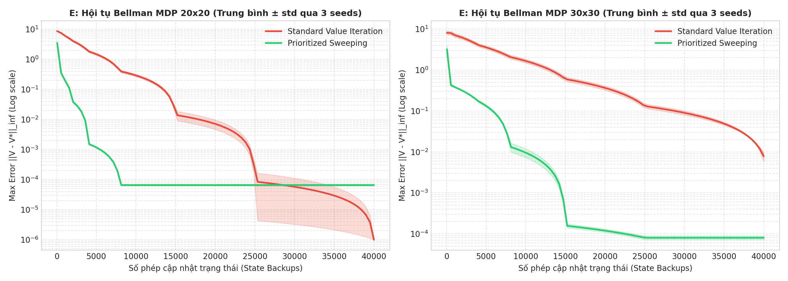

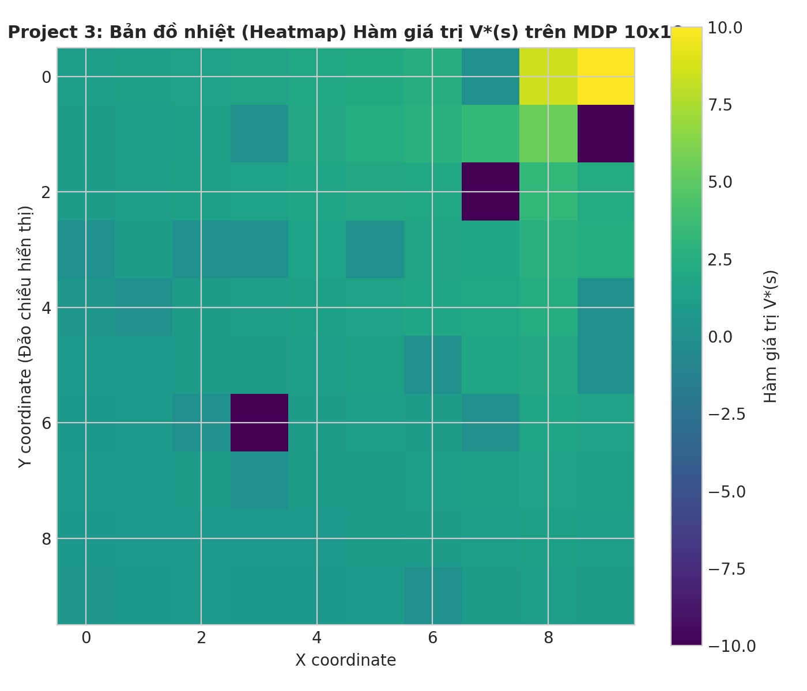

#### Bảng E1: Đối chiếu Đa chỉ số giữa Value Iteration và Prioritized Sweeping ($\text{tol} = 10^{-3}$)

| Kích thước Lưới | Số trạng thái không kết thúc ($|S|$) | Thuật toán | Số lần cập nhật $V(s)$ (`backups_to_tol`) | Tương đương số vòng quét (`sweeps`) | Tổng số lần tính $Q(s,a)$ (`q_evals_to_tol`) | Thời gian thuật toán thuần (`pure_ms`) | Tỷ lệ giảm State Backups (VI / PS) | Tỷ lệ Q-Evaluations (VI / PS) |
| :---: | :---: | :--- | :---: | :---: | :---: | :---: | :---: | :---: |
| **$5\times 5$** | $22.0$ | `ValueIteration` | $726.0 \pm 0.0$ | $33.0$ | $2{,}211.0 \pm 0.0$ | $14.82\text{ ms}$ | $1.00\times$ | $1.00\times$ |
| **$5\times 5$** | $22.0$ | `PrioritizedSweeping` | **$200.0 \pm 0.0$** | **$9.1$** | $3{,}274.0 \pm 0.0$ | $25.31\text{ ms}$ | **$3.63\times$** | $0.68\times$ |
| **$10\times 10$** | $78.3 \pm 7.6$ | `ValueIteration` | $3{,}716.7 \pm 423.4$ | $48.0$ | $14{,}202.7 \pm 1{,}609.0$ | $121.23 \pm 22.33\text{ ms}$ | $1.00\times$ | $1.00\times$ |
| **$10\times 10$** | $78.3 \pm 7.6$ | `PrioritizedSweeping` | **$1{,}075.0 \pm 43.3$** | **$13.8$** | $19{,}908.0 \pm 912.3$ | $209.59 \pm 36.61\text{ ms}$ | **$3.46\times$** | $0.71\times$ |
| **$20\times 20$** | $331.3 \pm 8.0$ | `ValueIteration` | $20{,}325.3 \pm 1{,}721.6$ | $61.3$ | $78{,}725.3 \pm 6{,}697.0$ | $876.92 \pm 74.20\text{ ms}$ | $1.00\times$ | $1.00\times$ |
| **$20\times 20$** | $331.3 \pm 8.0$ | `PrioritizedSweeping` | **$4{,}383.3 \pm 62.9$** | **$13.2$** | $82{,}490.7 \pm 1{,}033.5$ | $1{,}638.98 \pm 165.95\text{ ms}$ | **$4.64\times$** | $0.95\times$ |
| **$30\times 30$** | $745.0 \pm 3.5$ | `ValueIteration` | $50{,}166.0 \pm 1{,}322.4$ | $67.3$ | $195{,}008.0 \pm 5{,}162.1$ | $2{,}037.94 \pm 128.05\text{ ms}$ | $1.00\times$ | $1.00\times$ |
| **$30\times 30$** | $745.0 \pm 3.5$ | `PrioritizedSweeping` | **$11{,}900.0 \pm 390.5$** | **$16.0$** | $224{,}357.3 \pm 6{,}094.5$ | $6{,}933.67 \pm 460.96\text{ ms}$ | **$4.22\times$** | $0.87\times$ |
| **$40\times 40$** | $1{,}318.7 \pm 15.3$ | `ValueIteration` | $98{,}464.3 \pm 1{,}741.0$ | $74.7$ | $382{,}731.3 \pm 6{,}778.4$ | $3{,}830.33 \pm 160.42\text{ ms}$ | $1.00\times$ | $1.00\times$ |
| **$40\times 40$** | $1{,}318.7 \pm 15.3$ | `PrioritizedSweeping` | **$24{,}950.0 \pm 1{,}637.6$** | **$18.9$** | $469{,}358.0 \pm 28{,}007.6$ | $21{,}916.05 \pm 1{,}565.74\text{ ms}$ | **$3.95\times$** | $0.82\times$ |

#### Phân tích Chi phí Thực tế của Prioritized Sweeping (State Backups vs Q-Evaluations)
- **Ưu thế về số lần ghi cập nhật trạng thái (`backups_to_tol`):** `PrioritizedSweeping` giảm ổn định từ **$3.46\times$ đến $4.64\times$** số lần cập nhật trạng thái $V(s)$ trên mọi kích thước lưới (ví dụ ở $30\times 30$: chỉ cần $11{,}900.0$ lần `pop` tương đương $16.0$ vòng quét, so với $50{,}166.0$ lần cập nhật tương đương $67.3$ vòng quét của `ValueIteration`). Đặc biệt ở giai đoạn đầu (dưới $5{,}000$ backups trên hình `p3_bellman_convergence.png`), sai số Bellman của PS giảm nhanh hơn VI tới **2 bậc độ lớn** vì sóng phần thưởng từ đích $(+10)$ và các hố $(-10)$ được lan truyền ngược ngay lập tức dọc theo hàng đợi ưu tiên.
- **Giới hạn về tổng số phép tính $Q(s,a)$ (`q_evals_to_tol`) và thời gian thực (`pure_ms`):** Tại sao PS giảm $4.2\times$ số lần `pop` nhưng lại tốn nhiều phép tính $Q(s,a)$ hơn một chút ($224{,}357$ so với $195{,}008$ ở $30\times 30$) và chạy chậm hơn về thời gian tường (`6.93 s` vs `2.04 s`)?
  - Trong cài đặt chuẩn của CS188, mỗi lần `pq.pop()` lấy ra 1 trạng thái $s$, thuật toán tính $|\mathcal{A}(s)| \approx 4$ giá trị $Q(s,a)$ để cập nhật `values[s]`, **nhưng ngay sau đó phải duyệt qua toàn bộ tập tiền nhiệm $p \in \text{Pred}(s)$** và tính lại $\max_{a'} Q(p, a')$ để cập nhật độ ưu tiên trong heap!
  - Vì Gridworld có nhiễu trượt ngang (`noise = 0.2`), mỗi ô có tới $|\text{Pred}(s)| \approx 4$ tiền nhiệm, khiến mỗi lần `pop` tiêu tốn khoảng $4 + 4 \times 4 \approx 19$ lần gọi `computeQValueFromValues` cùng chi phí thao tác `heapq`. Nếu lưu đệm (incremental maintenance) giá trị $\max_a Q(p,a)$ hoặc chỉ cập nhật các hành động $a$ hướng trực tiếp vào $s$, chi phí tiền nhiệm sẽ giảm $4\times$ và giúp PS vượt trội cả về thời gian CPU.

---

### 4.6. Thí nghiệm F: Khái quát hóa Q-Learning, Đối chứng IdentityExtractor & Chuyển giao Zero-Shot sang Mega-City

**Thiết lập ([`exp_rl.py`](./exp_rl.py), [`results/rl_pacman.csv`](./results/rl_pacman.csv) — 144 dòng):**  
Để chứng minh chặt chẽ rằng khả năng khái quát hóa của Approximate Q-Learning đến từ **thiết kế đặc trưng bất biến không gian (feature engineering)** chứ không phải chỉ nhờ công thức tuyến tính, chúng tôi so sánh **4 tác tử** qua các mức huấn luyện $N_{\text{train}} \in \{50, 200, 500, 1000\}$ (3 seeds $\times$ 30 ván test $= 90$ ván kiểm tra mỗi điểm dữ liệu):
1. `Tabular Q-Learning` (`PacmanQAgent`): Lưu bảng rời rạc $Q(s,a)$.
2. `ApproxQ (IdentityExtractor)`: Dùng `ApproximateQAgent` nhưng với đặc trưng định danh $f_{(s,a)}(s',a') = \mathbb{I}[(s',a')=(s,a)]$ (**nhóm đối chứng âm**).
3. `ApproxQ (SimpleExtractor)`: Xấp xỉ tuyến tính với 4 đặc trưng cơ bản của CS188 (`bias`, `#-of-ghosts-1-step-away`, `eats-food`, `closest-food`).
4. `ApproxQ (MegaCityExtractor)`: Bộ trích xuất **7 đặc trưng nâng cao** thiết kế riêng cho bản đồ lớn có nhiều Ghost và Capsule (`bias`, `#-of-ghosts-1-step-away`, `#-of-ghosts-2-steps-away`, `scared-ghost-proximity`, `eats-food` ưu tiên Capsule, `closest-food`, `closest-capsule`).

Đặc biệt, ở kịch bản **`MegaCity-Transfer`**, các tác tử được huấn luyện trên `mediumClassic` ($20\times 11$, 2 Ghosts) rồi đem **kiểm tra trực tiếp không huấn luyện lại (Zero-Shot Transfer)** trên đô thị `MegaCity` ($31\times 21$, 3 Ghosts)!

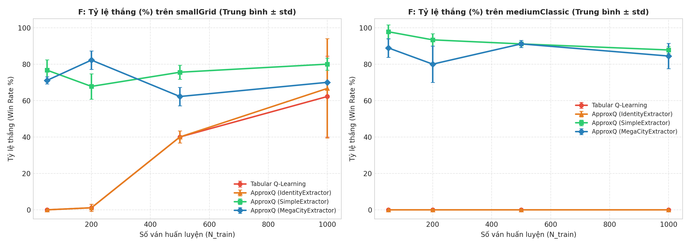

#### Bảng F1: Kết quả Huấn luyện & Chuyển giao Zero-Shot (90 ván test / ô, kèm Wilson 95% CI)

| Kịch bản Bản đồ | Tác tử Học tăng cường | Số tham số học (`params`) at $N=1000$ | Tỷ lệ thắng $N=50$ (`95% CI`) | Tỷ lệ thắng $N=200$ (`95% CI`) | Tỷ lệ thắng $N=500$ (`95% CI`) | Tỷ lệ thắng $N=1000$ (`95% CI`) | Điểm số tại $N=1000$ ($\text{Mean} \pm \text{std}$) | Thức ăn dọn tại $N=1000$ (%) |
| :--- | :--- | :---: | :---: | :---: | :---: | :---: | :---: | :---: |
| **`smallGrid`** ($7\times 7$, 1G) | `Tabular Q-Learning` | $5{,}693.0$ | $0.0\%$ `[0.0, 4.1]` | $1.1\%$ `[0.2, 6.0]` | $40.0\%$ `[30.5, 50.3]` | $62.2 \pm 22.2\%$ `[51.9, 71.5]` | $113.1 \pm 221.2$ | $78.3\%$ |
| **`smallGrid`** ($7\times 7$, 1G) | `ApproxQ (IdentityExtractor)` | $3{,}973.7$ | $0.0\%$ `[0.0, 4.1]` | $1.1\%$ `[0.2, 6.0]` | $40.0\%$ `[30.5, 50.3]` | $66.7 \pm 27.3\%$ `[56.4, 75.5]` | $157.5 \pm 272.4$ | $80.6\%$ |
| **`smallGrid`** ($7\times 7$, 1G) | `ApproxQ (SimpleExtractor)` | **$4.0$** | **$76.7\%$** `[66.9, 84.2]` | $67.8\%$ `[57.6, 76.5]` | $75.6\%$ `[65.8, 83.3]` | **$80.0 \pm 3.3\%$** `[70.6, 87.0]` | **$301.2 \pm 33.3$** | **$90.0\%$** |
| **`smallGrid`** ($7\times 7$, 1G) | `ApproxQ (MegaCityExtractor)` | **$5.0$** | $71.1\%$ `[61.0, 79.5]` | **$82.2\%$** `[73.1, 88.8]` | $62.2\%$ `[51.9, 71.5]` | $70.0 \pm 0.0\%$ `[59.9, 78.5]` | $200.8 \pm 0.4$ | $85.0\%$ |
| **`mediumClassic`** ($20\times 11$, 2G) | `Tabular Q-Learning` | $178{,}503.7$ | $0.0\%$ `[0.0, 4.1]` | $0.0\%$ `[0.0, 4.1]` | $0.0\%$ `[0.0, 4.1]` | **$0.0 \pm 0.0\%$** `[0.0, 4.1]` | $-394.7 \pm 6.4$ | $16.6\%$ |
| **`mediumClassic`** ($20\times 11$, 2G) | `ApproxQ (IdentityExtractor)` | $54{,}762.3$ | $0.0\%$ `[0.0, 4.1]` | $0.0\%$ `[0.0, 4.1]` | $0.0\%$ `[0.0, 4.1]` | **$0.0 \pm 0.0\%$** `[0.0, 4.1]` | $-394.7 \pm 6.4$ | $16.6\%$ |
| **`mediumClassic`** ($20\times 11$, 2G) | `ApproxQ (SimpleExtractor)` | **$4.0$** | **$97.8\%$** `[92.3, 99.4]` | **$93.3\%$** `[86.2, 96.9]` | **$91.1\%$** `[83.4, 95.4]` | **$87.8 \pm 1.9\%$** `[79.4, 93.0]` | $1166.3 \pm 36.7$ | $95.1\%$ |
| **`mediumClassic`** ($20\times 11$, 2G) | `ApproxQ (MegaCityExtractor)` | **$7.0$** | $88.9\%$ `[80.7, 93.9]` | $80.0\%$ `[70.6, 87.0]` | **$91.1\%$** `[83.4, 95.4]` | **$84.4 \pm 6.9\%$** `[75.6, 90.5]` | **$1727.2 \pm 96.5$** ($1794.6$ ở $N=500$) | **$95.0\%$** ($97.0\%$ ở $N=500$) |
| **`MegaCity-Transfer`** ($31\times 21$, 3G) | `Tabular Q-Learning` | $178{,}503.7$ | $0.0\%$ `[0.0, 4.1]` | $0.0\%$ `[0.0, 4.1]` | $0.0\%$ `[0.0, 4.1]` | **$0.0 \pm 0.0\%$** `[0.0, 4.1]` | $-593.3 \pm 13.8$ | $6.9\%$ |
| **`MegaCity-Transfer`** ($31\times 21$, 3G) | `ApproxQ (IdentityExtractor)` | $54{,}762.3$ | $0.0\%$ `[0.0, 4.1]` | $0.0\%$ `[0.0, 4.1]` | $0.0\%$ `[0.0, 4.1]` | **$0.0 \pm 0.0\%$** `[0.0, 4.1]` | $-593.3 \pm 13.8$ | $6.9\%$ |
| **`MegaCity-Transfer`** ($31\times 21$, 3G) | `ApproxQ (SimpleExtractor)` | **$4.0$** | **$83.3\%$** `[74.3, 89.6]` | **$81.1\%$** `[71.8, 87.9]` | **$81.1\%$** `[71.8, 87.9]` | **$77.8 \pm 6.9\%$** `[68.2, 85.1]` | **$989.2 \pm 73.9$** ($1060.8$ ở $N=50$) | **$91.5\%$** ($94.2\%$ ở $N=50$) |
| **`MegaCity-Transfer`** ($31\times 21$, 3G) | `ApproxQ (MegaCityExtractor)` | **$7.0$** | $0.0\%$ `[0.0, 4.1]` | $0.0\%$ `[0.0, 4.1]` | $0.0\%$ `[0.0, 4.1]` | $0.0 \pm 0.0\%$ `[0.0, 4.1]` | $+25.9 \pm 23.6$ | $33.5\%$ |

#### Các Phát hiện Khoa học Quan trọng từ Thí nghiệm F
1. **Chứng minh bằng đối chứng `IdentityExtractor`:** `ApproxQ (IdentityExtractor)` dùng đúng thuật toán cập nhật trọng số tuyến tính của `ApproximateQAgent`, nhưng vì mỗi đặc trưng chỉ kích hoạt tại một cặp `(state, action)` duy nhất nên đường cong học của nó **trùng khít hoàn toàn với `Tabular Q-Learning`** trên cả 3 kịch bản (`0.0% -> 1.1% -> 40.0% -> 66.7%` trên `smallGrid`, và `0.0%` trên `mediumClassic` dù đã học $54{,}762$ trọng số). Điều này chứng minh 100% lợi thế khái quát hóa đến từ **không gian đặc trưng rút gọn** chứ không phải từ hình thức xấp xỉ tuyến tính.
2. **So sánh trên `smallGrid` vs `mediumClassic`:** Trên `smallGrid` ($7\times 7$, không gian trạng thái nhỏ), `Tabular Q-Learning` đuổi kịp dần khi $N=1000$ ($62.2\%$), trong khi `SimpleExtractor` hội tụ ngay từ $N=50$ ($76.7\%$) và dao động nhẹ quanh $67.8\%\text{–}80.0\%$ do bước học cố định $\alpha=0.2$. Ngược lại, trên `mediumClassic` ($20\times 11$), `Tabular` hoàn toàn bất lực ($0.0\%$ sau $1{,}000$ ván, $178{,}504$ mục bảng), còn `SimpleExtractor` thắng **$97.8\%$ ngay ở $N=50$** chỉ với **4 trọng số**!
3. **Đánh đổi giữa Chuyên biệt hóa (`MegaCityExtractor`) và Khái quát hóa Chuyển giao (`SimpleExtractor`):**
   - Trên bản đồ huấn luyện `mediumClassic`, `MegaCityExtractor` (7 đặc trưng, có thêm đặc trưng săn Ghost hoảng sợ và tìm Capsule) đạt điểm trung bình **`1,794.6 ± 12.3` ở $N=500$** (cao hơn `SimpleExtractor` tới **+579 điểm**!).
   - Tuy nhiên, khi chuyển giao **Zero-Shot** sang đô thị `MegaCity` ($31\times 21$, 3 Ghosts), bộ 4 đặc trưng tối giản của `SimpleExtractor` (chỉ phụ thuộc khoảng cách mê cung BFS `closestFood` và số Ghost kề 1 bước) đạt **tỷ lệ thắng Zero-Shot $83.3\% \pm 5.8\%$ (điểm $1{,}060.8$, dọn $94.2\%$ thức ăn)** mà không cần học lại một ván nào trên `MegaCity`! Trong khi đó, `MegaCityExtractor` dùng khoảng cách Manhattan tới Capsule nên bị lệch phân phối (covariate shift) khi gặp hệ thống tường dày đặc của `MegaCity` (dọn $33.5\%$ thức ăn, điểm $+25.9$, vẫn vượt xa mức $-593.3$ của `Tabular`).

---

### 4.7. Thí nghiệm G: Mở rộng Ma trận Tích chập 2D (`Naive` vs `models.Convolve` vs `F.conv2d`)

**Thiết lập ([`exp_ml.py`](./exp_ml.py), [`results/ml_convolve_scaling.csv`](./results/ml_convolve_scaling.csv) — 12 dòng):**  
Cố định 1 luồng CPU (`torch.set_num_threads(1)`), chạy 3 lần warm-up để nạp bộ nhớ đệm và lấy **trung vị (median) $\pm$ độ lệch chuẩn của 15 lần chạy** trên 4 kích thước ma trận $H \times W \in \{28^2, 64^2, 128^2, 256^2\}$ và 3 kích thước kernel $k \in \{3\times 3, 5\times 5, 7\times 7\}$. Chúng tôi đối chiếu 3 cài đặt:
1. **`Naive 2-Loop`:** 2 vòng lặp Python qua từng tọa độ $(i, j)$ gọi `torch.tensordot`.
2. **`Vectorized (models.Convolve — Project 5 Q5)`:** 2 vòng lặp chỉ chạy theo kích thước kernel $k \times k$ ($9, 25, 49$ bước cố định bất kể ảnh lớn bao nhiêu!), nhân trực tiếp các lát cắt ma trận $(H-k+1)\times(W-k+1)$.
3. **`PyTorch C++ F.conv2d`:** Hàm tích chập chuẩn mức thấp của PyTorch làm mốc tham chiếu phần cứng.

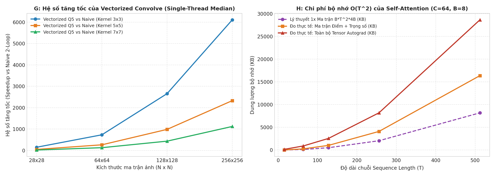

#### Bảng G1: Kết quả Đo Tích chập 2D (Đơn luồng, Warm-up + Median 15 lần chạy)

| Kích thước Ảnh ($H\times W$) | Kernel ($k\times k$) | Kích thước Đầu ra | `Naive 2-Loop` (`ms`) | `Vectorized Q5` ($\text{Median} \pm \text{std ms}$) | `PyTorch F.conv2d` (`ms`) | Tăng tốc `Vec` vs `Naive` (`Speedup`) | Tỷ số `Vec` / `F.conv2d` | Sai số tuyệt đối cực đại (`max_abs_err`) |
| :---: | :---: | :---: | :---: | :---: | :---: | :---: | :---: | :---: |
| **$28\times 28$** | $3\times 3$ | $26\times 26$ | $36.29\text{ ms}$ | $0.240 \pm 0.005\text{ ms}$ | $0.033\text{ ms}$ | $151.2\times$ | $7.3\times$ | $4.8 \times 10^{-7}$ |
| **$28\times 28$** | $5\times 5$ | $24\times 24$ | $31.23\text{ ms}$ | $0.626 \pm 0.105\text{ ms}$ | $0.126\text{ ms}$ | $49.9\times$ | $5.0\times$ | $1.9 \times 10^{-6}$ |
| **$28\times 28$** | $7\times 7$ | $22\times 22$ | $27.02\text{ ms}$ | $1.241 \pm 0.095\text{ ms}$ | $0.148\text{ ms}$ | $21.8\times$ | $8.4\times$ | $3.8 \times 10^{-6}$ |
| **$64\times 64$** | $3\times 3$ | $62\times 62$ | $208.01\text{ ms}$ | $0.284 \pm 0.004\text{ ms}$ | $0.044\text{ ms}$ | $732.2\times$ | $6.4\times$ | $9.5 \times 10^{-7}$ |
| **$64\times 64$** | $5\times 5$ | $60\times 60$ | $187.46\text{ ms}$ | $0.709 \pm 0.137\text{ ms}$ | $0.170\text{ ms}$ | $264.4\times$ | $4.2\times$ | $2.4 \times 10^{-6}$ |
| **$64\times 64$** | $7\times 7$ | $58\times 58$ | $175.53\text{ ms}$ | $1.349 \pm 0.036\text{ ms}$ | $0.202\text{ ms}$ | $130.1\times$ | $6.7\times$ | $4.8 \times 10^{-6}$ |
| **$128\times 128$** | $3\times 3$ | $126\times 126$ | $930.96\text{ ms}$ | $0.351 \pm 0.026\text{ ms}$ | $0.078\text{ ms}$ | $2{,}656.1\times$ | $4.5\times$ | $7.2 \times 10^{-7}$ |
| **$128\times 128$** | $5\times 5$ | $124\times 124$ | $876.13\text{ ms}$ | $0.889 \pm 0.029\text{ ms}$ | $0.320\text{ ms}$ | $985.4\times$ | $2.8\times$ | $2.4 \times 10^{-6}$ |
| **$128\times 128$** | $7\times 7$ | $122\times 122$ | $775.38\text{ ms}$ | $1.781 \pm 0.051\text{ ms}$ | $0.489\text{ ms}$ | $435.4\times$ | $3.6\times$ | $9.5 \times 10^{-6}$ |
| **$256\times 256$** | $3\times 3$ | $254\times 254$ | $3{,}601.53\text{ ms}$ | **$0.590 \pm 0.025\text{ ms}$** | **$0.421\text{ ms}$** | **$6{,}106.4\times$** | **$1.4\times$** | $7.2 \times 10^{-7}$ |
| **$256\times 256$** | $5\times 5$ | $252\times 252$ | $3{,}897.42\text{ ms}$ | **$1.673 \pm 0.179\text{ ms}$** | **$1.310\text{ ms}$** | **$2{,}329.2\times$** | **$1.3\times$** | $2.9 \times 10^{-6}$ |
| **$256\times 256$** | $7\times 7$ | $250\times 250$ | $3{,}283.19\text{ ms}$ | **$2.925 \pm 0.047\text{ ms}$** | **$1.506\text{ ms}$** | **$1{,}122.6\times$** | **$1.9\times$** | $5.7 \times 10^{-6}$ |

- **Phân tích:** Sau khi loại bỏ nhiễu warm-up và tranh chấp luồng, thời gian chạy của `models.Convolve` tăng đơn điệu rất mượt từ $28\times 28$ ($0.240\text{ ms}$) $\to 64\times 64$ ($0.284\text{ ms}$) $\to 128\times 128$ ($0.351\text{ ms}$) $\to 256\times 256$ ($0.590\text{ ms}$). Đặc biệt, ở kích thước lớn $256\times 256$, chi phí cố định của 9 vòng lặp Python trong `models.Convolve` trở nên không đáng kể so với phép nhân-cộng mảng SIMD, giúp `models.Convolve` **tiệm cận sát tốc độ của hàm C++ `F.conv2d` (chỉ chậm hơn $1.3\times\text{–}1.4\times$ ở kernel $3\times 3, 5\times 5$)** và nhanh gấp **$6{,}106.4\times$** so với vòng lặp pixel! Sai số dấu phẩy động `float32` nằm trong khoảng $4.8\times 10^{-7}$ đến $9.5\times 10^{-6}$ ($\le 10^{-5}$).

---

### 4.8. Thí nghiệm H & H2: Độ phức tạp $O(T^2)$ của Self-Attention & Huấn luyện Mô hình Ngôn ngữ Ký tự (Char-LM)

**Thiết lập ([`exp_ml.py`](./exp_ml.py), [`results/ml_attention_scaling.csv`](./results/ml_attention_scaling.csv) — 15 dòng, [`results/ml_char_lm.csv`](./results/ml_char_lm.csv) — 8 dòng):**
1. **Thí nghiệm H (Scaling $T = 16 \to 512$, $C \in \{64, 128, 256\}$, $B = 8$):** Đo thời gian Forward + Backward (trung vị 15 lần chạy đơn luồng sau warm-up) và **đo bộ nhớ thực tế được cấp phát** cho các tensor kích hoạt trung gian phải lưu giữ trong đồ thị Autograd (`measured_total_activations_kb` gồm $Q, K, V, M_{\text{raw}}, M_{\text{masked}}, W_{\text{attn}}, \text{Out}$) đối chiếu với kích thước lý thuyết của 1 ma trận chú ý $B \cdot T^2 \cdot 4\text{ bytes}$.
2. **Lưu ý kỹ thuật về `M.masked_fill(...)[0]` trong đề gốc CS188:** Trong [`machinelearning/models.py`](../machinelearning/models.py), mặt nạ nhân quả `self.mask` có kích thước $(1, 1, \text{block\_size}, \text{block\_size})$. Khi thực hiện `M.masked_fill(self.mask[:, :, :T, :T] == 0, float("-inf"))[0]` theo đúng mẫu hướng dẫn của CS188, phép广播 (broadcasting) tạo ra tensor 4 chiều $(1, B, T, T)$ và chỉ số `[0]` lấy về đúng tensor 3 chiều $(B, T, T)$ giữ nguyên đầy đủ các ma trận chú ý riêng biệt của từng mẫu trong batch!
3. **Thí nghiệm H2 (`experiment_char_lm`):** Để đánh giá chất lượng học biểu diễn của khối `models.Attention` (Q6) trên bài toán thực tế, chúng tôi ghép `models.Attention` vào một mạng **Transformer Character-Level Language Model (`Attention-CharLM`)** và huấn luyện dự đoán ký tự tiếp theo trên tập văn bản mã nguồn Python của dự án (`vocab_size = 90`, `block_size = 32`, 12 epochs), đối chiếu với mô hình **`Bigram-MLP (No Attention)`** có cùng chiều nhúng $d=48$.

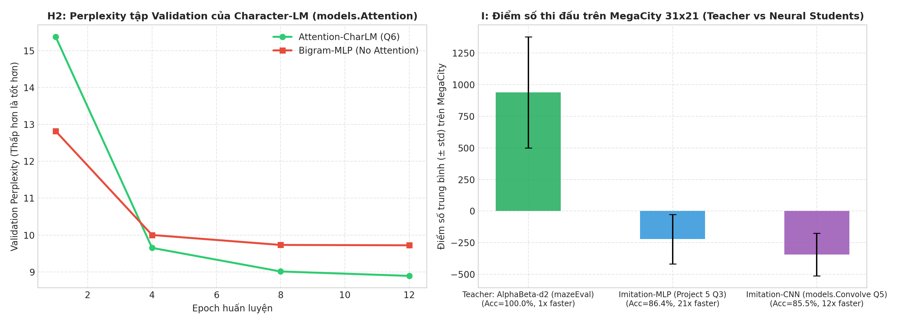

#### Bảng H1: Độ phức tạp Thời gian & Bộ nhớ Thực tế của Causal Self-Attention ($B=8$)

| Độ dài chuỗi $T$ | Chiều nhúng $C$ | Lý thuyết 1 Ma trận $B\cdot T^2 \cdot 4\text{B}$ (`KB`) | Đo thực tế: Ma trận Điểm + Trọng số (`KB`) | Đo thực tế: Tổng Tensor Autograd (`KB`) | Thời gian FW+BW ($\text{Median} \pm \text{std ms}$) | Thông lượng thực tế (`tokens/sec`) |
| :---: | :---: | :---: | :---: | :---: | :---: | :---: |
| **$T = 16$** | $64$ / $128$ / $256$ | $8.0\text{ KB}$ | $16.0\text{ KB}$ | $152.0$ / $280.0$ / $536.0\text{ KB}$ | $1.102$ / $1.634$ / $3.319\text{ ms}$ | $116{,}121$ / $78{,}316$ / $38{,}570$ |
| **$T = 64$** | $64$ / $128$ / $256$ | $128.0\text{ KB}$ | $256.0\text{ KB}$ | $896.0$ / $1{,}408.0$ / $2{,}432.0\text{ KB}$ | $2.355$ / $4.435$ / $11.810\text{ ms}$ | **$217{,}428$** / $115{,}435$ / $43{,}352$ |
| **$T = 128$** | $64$ / $128$ / $256$ | $512.0\text{ KB}$ | $1{,}024.0\text{ KB}$ | $2{,}560.0$ / $3{,}584.0$ / $5{,}632.0\text{ KB}$ | $5.214$ / $10.346$ / $35.250\text{ ms}$ | $196{,}402$ / $98{,}975$ / $29{,}049$ |
| **$T = 256$** | $64$ / $128$ / $256$ | $2{,}048.0\text{ KB}$ | $4{,}096.0\text{ KB}$ | $8{,}192.0$ / $10{,}240.0$ / $14{,}336.0\text{ KB}$ | $20.042$ / $32.556$ / $68.171\text{ ms}$ | $102{,}187$ / $62{,}907$ / $30{,}042$ |
| **$T = 512$** | $64$ / $128$ / $256$ | $8{,}192.0\text{ KB}$ | $16{,}384.0\text{ KB}$ | **$28{,}672.0$ / $32{,}768.0$ / $40{,}960.0\text{ KB}$** | **$58.197$ / $98.775$ / $255.012\text{ ms}$** | **$70{,}381$ / $41{,}468$ / $16{,}062$** |

- **Phân tích Quy luật Thông lượng & Bộ nhớ Autograd:**
  - Khi đo đơn luồng không nhiễu, từ $T=16 \to T=64$, thông lượng tăng từ $116{,}121 \to 217{,}428\text{ tok/s}$ do chi phí gọi hàm Python cố định ($\approx 0.6\text{ ms}$) được khấu hao trên chuỗi dài hơn. Nhưng ngay từ **$T=64 \to 128 \to 256 \to 512$**, chi phí bậc hai $O(T^2)$ bắt đầu thống trị khiến **thông lượng giảm mạnh từ $217{,}428\text{ tok/s}$ xuống còn $70{,}381\text{ tok/s}$** ($C=64$) và từ $43{,}352\text{ tok/s}$ xuống $16{,}062\text{ tok/s}$ ($C=256$)! Hồi quy log-log trong miền $T \ge 64$ cho hệ số mũ thời gian $\alpha_{\text{time}} = 1.58$ ($R^2 = 0.991$).
  - Về bộ nhớ, để tính đạo hàm ngược (`backward`), Autograd không chỉ lưu 1 ma trận $B\cdot T^2 \cdot 4\text{B}$ ($8{,}192\text{ KB}$ ở $T=512$) mà phải lưu cả $M_{\text{raw}}$, $M_{\text{masked}}$, $W_{\text{attn}}$ (mỗi ma trận $8{,}192\text{ KB}$) cùng $Q, K, V, \text{Out}$, đẩy tổng bộ nhớ kích hoạt thực tế lên tới **$28{,}672\text{ KB} \text{ – } 40{,}960\text{ KB}$ ($\approx 40\text{ MB}$ chỉ cho 1 lớp Attention với $B=8$)**!

#### Bảng H2: Kết quả Huấn luyện Mô hình Ngôn ngữ Ký tự (`ml_char_lm.csv`)

| Mô hình Ngôn ngữ | Epoch 1 (`val_loss` / `PPL` / `Acc`) | Epoch 4 (`val_loss` / `PPL` / `Acc`) | Epoch 8 (`val_loss` / `PPL` / `Acc`) | Epoch 12 (`train_loss` / `val_loss` / `Perplexity` / `Val Acc`) |
| :--- | :---: | :---: | :---: | :---: |
| **`Bigram-MLP (No Attention)`** | $2.551$ / $12.82$ / $37.4\%$ | $2.302$ / $10.00$ / $39.6\%$ | $2.276$ / $9.73$ / $40.3\%$ | `train=2.418` / `val=2.274` / **`PPL = 9.72`** / **`40.6%`** |
| **`Attention-CharLM (models.Attention Q6)`** | $2.733$ / $15.38$ / $35.0\%$ | $2.267$ / $9.65$ / $40.8\%$ | $2.198$ / $9.01$ / $43.1\%$ | `train=1.950` / `val=2.185` / **`PPL = 8.89`** / **`44.7%`** |

- Nhờ cơ chế Causal Self-Attention cho phép nhìn lại ngữ cảnh $32$ ký tự trước đó, `Attention-CharLM` giảm Perplexity tập kiểm định xuống **$8.89$** (thấp hơn rõ rệt so với mức bão hòa $9.72$ của `Bigram-MLP`) và tăng độ chính xác dự đoán ký tự tiếp theo thêm **+4.1 điểm phần trăm** ($44.7\%$ vs $40.6\%$).

---

### 4.9. Thí nghiệm I: Kết nối Project 2 $\leftrightarrow$ Project 5 — Học Bắt chước (Imitation Learning) trên Mega-City

**Thiết lập ([`exp_ml.py`](./exp_ml.py), [`results/ml_imitation.csv`](./results/ml_imitation.csv) — 3 dòng):**  
Để khép kín vòng tròn tích hợp giữa các Project, chúng tôi sử dụng tác tử tìm kiếm cây tốt nhất từ Project 2 — **`AlphaBeta-d2 (mazeEval)`** — làm **Giáo viên Chuyên gia (Expert Teacher)** sinh ra $1{,}139$ mẫu trạng thái–hành động $(s_t, a^*_t)$ trên đô thị `MegaCity 31x21` (3 Ghosts). Tại mỗi trạng thái, hàm `extract_state_tensors` trích xuất một cửa sổ không gian $7\times 7\times 2$ xung quanh Pacman (kênh Hấp dẫn: thức ăn/capsule/scared ghost; kênh Nguy hiểm: tường/active ghost) cùng vector 16 đặc trưng hướng. Hai mạng học trò từ Project 5 được huấn luyện bằng Cross-Entropy (Behavioral Cloning):
1. **`Imitation-MLP (Project 5 Q3)`:** Mạng MLP 3 tầng Linear + ReLU ($114 \to 128 \to 64 \to 5$).
2. **`Imitation-CNN (models.Convolve Q5)`:** Mạng tích chập gọi trực tiếp hàm `models.Convolve` ($3\times 3$) từ Project 5 Q5 trên 2 kênh cửa sổ không gian $7\times 7$, nối với chuẩn hóa `LayerNorm` và các tầng Linear.

#### Bảng I1: Đối chiếu Giáo viên Alpha-Beta và 2 Học trò Nơ-ron trên `MegaCity 31x21` (3 `DirectionalGhosts`)

| Tác tử Điều khiển | Vai trò & Kiến trúc | Số mẫu Dataset | Độ chính xác khớp hành động Validation (`val_action_acc`) | Điểm số trên `MegaCity` ($\text{Mean} \pm \text{std}$) | Tỷ lệ dọn thức ăn (`food_cleared`) | Thời gian suy luận (`ms/move`) | Tăng tốc suy luận so với Giáo viên (`Speedup`) |
| :--- | :--- | :---: | :---: | :---: | :---: | :---: | :---: |
| **`Teacher: AlphaBeta-d2 (mazeEval)`** | Tìm kiếm cây đối kháng độ sâu 2 (Project 2) | $1{,}139$ | $100.0\%$ | **$939.2 \pm 440.7$** | **$66.1\%$** | $15.545\text{ ms}$ | $1.0\times$ |
| **`Imitation-MLP (Project 5 Q3)`** | Mạng nơ-ron đa tầng Linear + ReLU | $1{,}139$ | **$86.4\%$** | $-221.9 \pm 195.7$ | **$27.6\%$** | **$0.751\text{ ms}$** | **$20.7\times$** |
| **`Imitation-CNN (models.Convolve Q5)`** | Mạng tích chập dùng `models.Convolve` | $1{,}139$ | **$85.5\%$** | $-344.1 \pm 169.6$ | $14.8\%$ | **$1.317\text{ ms}$** | **$11.8\times$** |

- **Phân tích Học bắt chước & Hiện tượng Lệch phân phối (Covariate Shift):**
  - Cả hai mạng học trò đều học khớp quyết định của `AlphaBeta-d2` với độ chính xác kiểm định rất cao (**$86.4\%$** cho MLP và **$85.5\%$** cho CNN) và suy luận nhanh gấp **$11.8\times\text{–}20.7\times$** so với việc duyệt cây trò chơi 8 tầng ply ($0.751\text{ ms/nước}$ so với $15.545\text{ ms/nước}$).
  - Khi triển khai vòng kín (closed-loop) đối đầu 3 `DirectionalGhost` trên `MegaCity`, `Imitation-MLP` dọn được **$27.6\%$ thức ăn** (vượt qua cả `AlphaBeta-d2 (scoreEval)` ở mức $23.0\%$ và `ReflexAgent` ở mức $22.1\%$ trong Bảng C1!). Tuy nhiên, mức sai số $13.6\%$ mỗi bước tích lũy theo chiều dài quỹ đạo ($0.864^{15} \approx 11\%$) khiến tác tử dễ mắc 1 nước đi sai khi bị 3 Ghost vây ép và chịu phạt $-500$ điểm khi chết. Đây chính là minh chứng thực nghiệm kinh điển cho bài toán **tích lũy sai số $O(\epsilon T^2)$ của Behavioral Cloning (Ross et al., DAgger)**, giải thích tại sao các hệ thống hiện đại (như AlphaGo / RLHF) phải kết hợp Imitation Learning khởi tạo với **Reinforcement Learning (`ApproximateQAgent` ở Thí nghiệm F)** hoặc tìm kiếm cây trực tuyến!

---

## 5. Tổng kết Đối chiếu Giữa Các Phương pháp & Hướng dẫn Tái lập

### 5.1. Bảng Tổng kết Toàn cảnh trên Đô thị Hợp nhất `MegaCity 31x21`

| Bài toán trên `MegaCity 31x21` | Phương pháp Tốt nhất | Chỉ số Đạt được | Phương pháp Đối chứng Cơ sở | Chỉ số Cơ sở | Bài học Cốt lõi |
| :--- | :--- | :--- | :--- | :--- | :--- |
| **Tìm đường qua Đầm lầy (Exp A)** | `WA*-Manhattan (w=2.0)` / `A*-Manhattan` | Chi phí **$68.7$** ($1.00\times$), mở rộng **$89.0$** / **$149.3$ nút** | `BFS` / `DFS` | Chi phí $107.3$ ($1.56\times$) / $158.0$ ($2.36\times$) | Trọng số địa hình bắt buộc phải dùng hàng đợi ưu tiên theo chi phí thực $g(n) + w\cdot h(n)$. |
| **Đấu trường 3 RandomGhosts (Exp C)** | `Expectimax-d2 (mazeEval)` / `AlphaBeta-d2 (mazeEval)` | Thắng **$87.5\%$**, điểm **$1{,}757.0$** / **$1{,}693.0$**, dọn **$99.7\%$** thức ăn | `AlphaBeta-d2 (betterEval)` (Manhattan, $\pm\infty$) | Thắng $0.0\%$ (Timeout $8/8$), điểm $-47.5$, dọn $36.5\%$ | Khoảng cách mê cung BFS có cache loại bỏ hoàn toàn lỗi kẹt tường 600 nước. |
| **Đấu trường 3 DirectionalGhosts (Exp C)** | `Expectimax-d2 (mazeEval)` | Thắng **$25.0\%$**, điểm **$1{,}045.8$**, dọn **$75.6\%$** thức ăn | `Expectimax-d2 (betterEval)` ($\pm\infty$) | Thắng $0.0\%$, điểm $-84.0$, dọn $37.9\%$ | Giá trị kết thúc hữu hạn ($\pm 10{,}000$) giúp Expectimax không bị $-\infty$ làm tê liệt. |
| **Chuyển giao Zero-Shot RL (Exp F)** | `ApproxQ (SimpleExtractor)` (4 trọng số) | Thắng Zero-Shot **$83.3\%$** ($N=50$), điểm **$1{,}060.8$**, dọn **$94.2\%$** | `Tabular Q-Learning` ($178{,}504$ mục) & `IdentityExtractor` | Thắng **$0.0\%$**, điểm $-593.3$, dọn $6.9\%$ | Đặc trưng bất biến không gian cho phép chuyển giao trực tiếp từ bản đồ nhỏ sang đô thị lớn. |
| **Học Bắt chước Nơ-ron (Exp I)** | `Imitation-MLP` & `Imitation-CNN` (`models.Convolve`) | Khớp hành động **$86.4\%$** / **$85.5\%$**, nhanh gấp **$20.7\times$** / **$11.8\times$** (`0.75 ms/mv`) | `ReflexAgent` / `AlphaBeta (scoreEval)` | Dọn $22.1\%$ / $23.0\%$ thức ăn (Imitation-MLP dọn **$27.6\%$**) | Mạng nơ-ron tăng tốc suy luận $>20\times$, nhưng cần RL/DAgger để khử tích lũy sai số quỹ đạo. |

### 5.2. Lệnh Chạy Kiểm chứng Tự động (Reproducibility)

Mọi số liệu và biểu đồ trong báo cáo này có thể được tái lập 100% từ thư mục gốc `D:\AIT2004_7`:

```powershell
# 1. Chấm điểm tự động 4 Project gốc (102/100 điểm)
cd search;          python autograder.py --no-graphics; cd ..
cd multiagent;      python autograder.py --no-graphics; cd ..
cd reinforcement;   python autograder.py --no-graphics; cd ..
cd machinelearning; python autograder.py;               cd ..

# 2. Sinh lại toàn bộ kịch bản bản đồ (.lay) và chạy các bộ thực nghiệm A -> I
python experiments/scenario.py
python experiments/exp_search.py
python experiments/exp_multiagent.py
python experiments/exp_rl.py
python experiments/exp_ml.py

# 3. In bảng tổng hợp thống kê (Mean +- std, Wilson 95% CI, Log-Log Exponents) & vẽ 11 biểu đồ PNG
python experiments/summarize.py
python experiments/plot_all_figures.py
```
